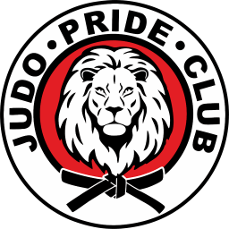

# Дизайн-система JudeOSLite / PRIDE

Извлечено из [judopride.by](https://judopride.by/) 11 октября 2026 года. Это основа визуального языка будущего проекта, а не полный брендбук клуба. Проверены главная страница, её CSS, вычисленные стили и экраны шириной 1280 и 390 px.

**Статусы:** «Извлечено» — подтверждено текущим сайтом; «Рекомендация» — правило для будущего проекта. Имена токенов нормализованы для повторного использования.

**Текущий frontend:** пользовательская адаптация макетов от 19.10.2026 описана в
[корневом DESIGN.md](../DESIGN.md) и разделе RD-08 ниже. Таблицы извлечения 11.10,
`tokens.css`/`tokens.json`, preview и предыдущие прототипы сохраняют свои исходные
значения и происхождение; это исторические источники, а не финальные runtime-токены.

## Визуальный характер

**Извлечено.** Светлый спортивный интерфейс: яркий красный акцент, тёмные жирные заголовки Rubik, белые и холодные серые поверхности, мягкие скругления, реальные фотографии тренировок. Эмблема клуба — круглый знак со львом. Красный выделяет действия, активную навигацию и возрастные метки; фотографии несут большую часть эмоционального содержания.

**Рекомендация.** Сохранять эту узнаваемость в будущем проекте. Для рабочих экранов использовать спокойные поверхности, красный оставлять для главных действий и выбранных элементов. Маркетинговый первый экран сайта не определяет устройство будущего приложения.

## Логотип и графика



- [logo-pride.png](assets/logo-pride.png) — оригинальный PNG 256 × 256, RGBA, скачан без перерисовки из `/img/logoalter.png`.
- Надпись «Клуб дзюдо Прайд» в шапке набрана отдельно: Rubik 600, 15 px, line-height 1.15, uppercase, `#444444`; на маленьком экране — 11 px. Она не входит в PNG.
- На мобильном экране эмблема отображается размером 44 × 44 px. Для интерфейса рекомендовано 44–56 px; для крупной печати нужен оригинал большего разрешения.
- [judo-calligraphy.png](assets/judo-calligraphy.png) — исходный декоративный ресурс с японской каллиграфией. На сайте скрывается при ширине ≤991 px.
- В просмотренной странице векторного оригинала логотипа не найдено. SVG-версия не создавалась.

**Рекомендация.** Не растягивать и не перекрашивать эмблему. Оставлять свободное поле минимум ¼ её диаметра; это предложенное правило, не подтверждённое требование бренда. Использовать PNG на чистой светлой поверхности.

## Цвета

| Токен | Значение | Роль и доказательство |
| --- | --- | --- |
| `brand` | `#DB0C0C` | Основной акцент, исходный `--main-red`, CTA, активная навигация |
| `brand-hover` | `#323232` | Фон `.button-order:hover` |
| `text` | `#212529` | Фактически вычисленный цвет основного текста и заголовков |
| `brand-ink` | `#282828` | Исходный `--main-black`; не заменяет основной текст автоматически |
| `surface` | `#FFFFFF` | Страница, шапка, белые карточки |
| `surface-subtle` | `#F5F7FA` | Hero, вторичные панели, бейдж стоимости |
| `surface-section` | `#EFF3F9` | Секция тренеров |
| `surface-field` | `#FAFAFA` | Общие поля ввода |
| `surface-search` | `#F6F8FC` | Поиск в шапке |
| `border` | `#DEDEDE` | Границы вспомогательных элементов |
| `text-field` | `#444862` | Текст полей |
| `text-muted` | `#6B747A` | Текст выбора города |
| `text-muted-source` | `#8C9097` | Кнопка входа на источнике; только исторический образец |
| `link-source` | `#3F74E8` | Исходный `--link-col`, ссылки в тексте |
| `link-hover-source` | `#7D99FF` | Общий hover ссылок источника |

В исходном CSS переменная `--color-text-dark` повреждена: после `#3c3c40` пропущена точка с запятой. Поэтому основной текст визуально наследует `#212529` из Bootstrap. Палитра здесь опирается на фактическое отображение. Розовый `--primary-color: #ff3c78` и вся служебная палитра Bootstrap не приняты за основные цвета бренда.

**Рекомендация.** На красном фоне использовать белый текст. Для второстепенного текста на белом подходит исходный `text-muted`; на серых поверхностях использовать добавленный `text-secondary: #626B72`, который сохраняет контраст ≥4.5:1. Цвет `#8C9097` не переносить на важные мелкие подписи. Для текстовых ссылок использовать красный с подчёркиванием: светлый hover `#7D99FF` исходного сайта имеет слабый контраст на белом. Семантические цвета ошибок, предупреждений и успеха требуют отдельного проектного решения; статус нельзя показывать только цветом.

## Типографика

**Извлечено.** Единственный основной шрифт — **Rubik**, normal. Сайт запрашивает веса 300, 400, 500, 600, 700, 800, 900 через Google Fonts. Сохранены локальные WOFF2 с кириллицей, расширенной кириллицей, латиницей и расширенной латиницей; подключение — [fonts.css](fonts/fonts.css). Лицензия — [SIL Open Font License](fonts/OFL-Rubik.txt). Курсив не извлечён.

| Стиль | Размер | Вес | Межстрочный интервал |
| --- | --- | --- | --- |
| H1 | `clamp(1.875rem, 1.61538rem + 1.15385vw, 3rem)` | 700 | 1.2 |
| H2 | `clamp(1.4375rem, 1.26442rem + 0.769231vw, 2.1875rem)` | 700 | 1.2 |
| H3 | 25 px | 600 | 1.2 |
| H4 | 24 px | 600 | 1.2 |
| Основной абзац | 16 px | 400 | 1.6 |
| Абзац при ширине ≥1367 px | 17 px | 400 | 1.7 |
| Абзац при ширине ≤991 px | 14 px | 400 | 1.6 |
| CTA | 14 px, uppercase | 500 | 1.5 |
| Поле ввода | 14 px | 400 | 20 px |
| Возрастной бейдж | 13 px | 500 | наследуется |
| Заголовок новости | 17 px | 600 | 1.3 |

На 1280 px H1 ≈40.62 px и H2 ≈30.08 px. При ширине ≤575 px H2 переопределён на 24 px. `strong` / `b` — 600. Для иконок подключён **Material Symbols Rounded** (`opsz=48`, `wght=200`, `FILL=1`, `GRAD=0`); исходная декларация сохранена в evidence, бинарный иконочный шрифт не включён в пакет.

**Рекомендация.** Сохранить Rubik 400/500/600/700 как рабочий набор. Для приложения на телефоне оставлять основной текст 16 px, даже если сайт уменьшает его до 14 px. Лигатуры иконочного шрифта не должны озвучиваться как текст; у кнопки с иконкой должно быть доступное имя.

## Сетка, отступы, форма

**Извлечено.** Сайт использует Bootstrap 5.3.3, 12 колонок и переопределённый `.container { max-width: 1260px; }`. В главном контейнере горизонтальный padding 12 px с каждой стороны. Hero на широком экране разделён на две колонки; на телефоне фото находится над текстом. Шапка имеет два уровня на desktop и компактную строку с меню на ширине ≤991 px.

- Опорные отступы исходника: 4, 8, 16, 32 px; в компонентах также используются 10, 12, 15, 20, 25, 30, 40, 48 и 80 px.
- Секция `.py-5`: 48 px сверху/снизу, на ширине ≤575 px — 32 px.
- Секция `.py-6`: 80 px сверху/снизу, на ширине ≤991 px — 32 px.
- Панель: padding 40 px; компактная — 30 px; radius 20 px.
- Кнопка: radius 5 px; поле — 10 px; поиск — 7 px; крупное фото hero — 30 px; бейдж — 30 px.
- Брейкпоинты сетки: 576, 768, 992, 1200, 1400 px. Дополнительный порог типографики — 1367 px.

**Рекомендация.** Использовать базовую шкалу 4/8/12/16/20/24/32/40/48/64/80 px, сохраняя документированные значения при точном воспроизведении источника. На телефоне давать рабочему экрану padding 16 px. Для новых таблиц и форм выбирать компактность по задаче; не переносить все декоративные маркетинговые блоки.

## Основные компоненты

| Компонент | Извлечённые правила |
| --- | --- |
| Основная кнопка | Красный фон, белый Rubik 500 14 px uppercase; padding 15 × 25 px; radius 5 px; тень `0 19px 36px -17px #DB0C0C` |
| Hover кнопки | Фон `#323232`, сдвиг вверх 5 px; тень `0 19px 36px -12px #373737`; transition 300 ms linear |
| Вторичная кнопка входа | `#F5F7FA`, граница `#DEDEDE` 1 px, radius 5 px, padding 10 × 20 px, 14 px / 400 |
| Поле ввода | Высота 50 px, padding 15 × 20 px, фон и граница `#FAFAFA`, radius 10 px, текст `#444862` |
| Поиск | Высота 45 px, radius 7 px, фон `#F6F8FC`, padding 10px 60px 10px 25px |
| Карточка направления | Белая, radius 20 px, padding 30 × 20 px, центрирование; заголовок 20 px / 600; тень `0 19px 36px -12px #DEDEDE`; hover вверх 7 px |
| Метка возраста | Красный фон, белый текст, 13 px / 500, padding 3 × 10 px, radius 30 px |
| Метка стоимости | Фон `#F5F7FA`, 12 px, padding 3 × 10 px, radius 30 px |
| FAQ | Разделитель `#E5E5E5` 1 px; заголовок 20 px / 500, на ≤991 px — 16 px; раскрытый пункт красный; круглый плюс превращается в минус |
| Навигация | Rubik 400 16 px, padding 2 × 15 px, radius 4 px; hover/active — белый на красном |

**Рекомендации для реализации.** Видимый `:focus-visible`, touch target минимум 44 × 44 px, явные состояния disabled/loading/error, подписи полей и текст ошибки, `aria-expanded` у раскрывающихся элементов, поддержка `prefers-reduced-motion`. Эти правила добавлены для будущего проекта. Глобальное `outline: none !important` и бесконечные декоративные анимации исходника переносить не следует.

## Файлы и подключение

- [design-system/tokens.css](tokens.css) — проверенные переменные `--pride-*`, без глобального изменения страницы.
- [design-system/tokens.json](tokens.json) — те же переменные с источниками и отдельными рекомендациями.
- [design-system/components.css](components.css) — необязательные базовые стили классов `.pride-*` с доступными состояниями.
- [design-system/preview.html](preview.html) — локальная визуальная витрина: логотип, палитра, типографика, компоненты.
- [design-system/manifest.json](manifest.json) — происхождение, размеры, хеши и лицензии ресурсов.
- `evidence/` — CSS, сериализованный браузером, измерения и снимки источника. Эти CSS сохраняют сторонние и устаревшие правила; подключать их в приложение не нужно.

```css
@import './fonts/fonts.css';
@import './tokens.css';
@import './components.css';
```

Ресурсы бренда сохраняют принадлежность исходному клубу; лицензия Rubik приложена отдельно. Пакет не устанавливает права на логотип. Дизайн административных экранов, тёмная тема и полная система продуктовых состояний на этой странице не подтверждены.


## Рабочая оболочка React — RD-01

Выбранная [Working Panel](prototypes/dashboard/DESIGN.md) перенесена в оболочку существующего приложения по отдельному поручению #183. Исходные PRIDE-токены, Rubik и оригинальный логотип сохранены. Локальная плотность/семантические рекомендации `--panel-*` определены в frontend/src/app/app.css и описаны в [контракте навигации](../docs/redesign-navigation.md). Они отделены от подтверждённых цветов источника; новый бренд не вводится. Статический prototype/preview остаётся самостоятельным reference, без подключения его JS/демоданных к React. Предметные экраны и ролевые главные переходят отдельно в RD-02–RD-05.


## Рабочий frontend — RD-07 / shadcn, 18.10.2026

**Исторический этап / реализованная адаптация.** Выбранный шаблон
`prototypes/shadcn-app/` на `17ecd57068cff17e4eaf055e0ac503b61cab0399`
перенесён в существующий frontend по #198. Этот раздел дополняет извлечение
11.10 и историю RD-01 выше; исходные значения, файлы ресурсов и их происхождение
не меняются. Текущий нормативный runtime после RD-08 отражает
[корневой DESIGN.md](../DESIGN.md); машинные расширения и изолированные образцы —
[.impeccable/design.json](../.impeccable/design.json). Значения этого исторического
раздела относятся к переносу 18.10.

- **Унаследовано из источника:** Rubik, оригинальная эмблема, красный/тёмный hover,
  холодные поверхности, радиусы кнопки5px/поля10px/панели20px. Шрифты и
  `--pride-*` импортируются из общих файлов; ресурсы не перерисованы.
- **Адаптация выбранного шаблона:** основной текст14px/1.5 desktop и16px/1.5
  mobile, заголовки30/26px и панели17px. Это рабочая плотность, а не изменение
  таблицы исходной типографики выше. Secondary text, divider, навигационные и
  success/warning оттенки — проектные рекомендации, не извлечение бренда.
- **Оболочка:** Sidebar248/76px и шапка80px на ПК; ниже768px Sidebar отсутствует,
  шапка72px, три частых разрешённых раздела по роли и «Ещё». Workspace32px/16px;
  native forms и shadcn/Radix nova-компоненты разделяют семантическую тему в
  `frontend/src/app/shadcn.css` и `app.css`. Source-reviewed компоненты взяты из
  закреплённого эталона; MIT notice — `frontend/src/components/SHADCN-LICENSE.md`.
- **Строки и действия:** участник открывается по имени, статусы имеют доступную
  подпись; сотрудники с аватаром44px и отступами16×12px; числа сводки выровнены
  под переносимыми подписями. Дата и стрелки объединены, desktop32px/mobile44px.
- **Полные формы:** native sheets используют общую тему; sticky header с
  верхним выходом44×44px вызывает прежний guarded cancel, учитывает busy и
  сохраняет нижнюю отмену. Профиль использует фактические данные/logout;
  сворачивание меню применяется в текущей вкладке без фиктивного сохранения.

Карта операций и границы — [docs/shadcn-runtime.md](../docs/shadcn-runtime.md).
Демонстрационные регистры, роли и данные не входят в runtime. Backend/API,
серверные права, история, даты, CSRF и lifecycle/PWA не переопределяются дизайном.
[Документационная сверка](../.impeccable/review/shadcn-runtime/documenter.md)
фиксирует только этот срез системы; finish-verdict относится к единственному
исправлению верхнего выхода. Итоговые browser/PWA результаты и ограничения
учитываются отдельно в протоколе проверки; этот раздел не удостоверяет физическую
установку PWA или пользовательскую приёмку нового оформления.

## Рабочий frontend — RD-08 / макеты PRIDE CLUB OS, 19.10.2026

**Прямое поручение заказчика / реализованная адаптация frontend.** Три приложенных
макета закреплены как `user-screenshots-20261019`, code-led, в
[контракте поверхности](../.impeccable/surfaces/frontend-src-app-app-tsx.md).
Композиция и язык макетов заменяют прежний shadcn-app как визуальный эталон
рабочего frontend по #200. Это не новое извлечение сайта 11.10 и не подтверждение
готовности серверных модулей.

- **Палитра и поверхности.** Основное действие и активная навигация —
  `#c8102e`, hover — `#a50d26`, рабочий фон — `#f2f6f9`. Белые панели имеют
  радиус 16px и мягкую смещённую тень `0 4px 18px rgb(32 51 75 / 4%)`.
  Новая модульная карточка на телефоне использует радиус 14px; существующие
  панели и метрики сохраняют 16px. Это значения адаптации макетов, не замена
  извлечённых `brand:#DB0C0C`, `brand-hover:#323232` и `panel:20px` в архиве
  источника. Исходный красный остаётся отдельной ролью focus/destructive.
- **Оболочка и чтение.** Sidebar 248/76px, шапка 80px на ПК и 72px на телефоне,
  workspace 32px/16px; ниже 768px Sidebar отсутствует в DOM. Основной Rubik
  14px/1.5 desktop и 16px/1.5 mobile сохранён. Четыре метрики главной на телефоне
  складываются в две колонки; предметные списки и полные формы адаптируются
  без сжатия длинных имён.
- **Движение.** Sidebar, шапка и workspace меняют ширину/смещение синхронно
  за 220ms с `cubic-bezier(.22,1,.36,1)`. Подписи меню сохраняют целую строку,
  скрываются прозрачностью/отсечением, не сжимаются и не переносятся. Выбранное
  состояние применяется сразу. `prefers-reduced-motion` отключает движение,
  переходы и плавную прокрутку.
- **Контролы и вкладки.** shadcn/Radix разделяют тему с native-формами.
  Вкладки — прозрачная поверхность, активные красный текст и нижняя линия 2px;
  на телефоне подпись 16px. В карточке участника полоса прокручивается,
  выбранная вкладка раскрывается в видимую область при выборе/изменении ширины.
  Pointer-focus не оставляет прямоугольный outline; клавиатурный фокус видим.
  Sticky header полных native sheets сохраняет выход 44×44px и guarded cancel.
- **Ресурсы.** Оригинальный `assets/logo-pride.png` и локальный Rubik не
  перерисованы и не заменены. Их источники, хеши и лицензии остаются в
  [manifest.json](manifest.json) и [OFL-Rubik.txt](fonts/OFL-Rubik.txt).
  Новые shipping raster-ресурсы для этого оформления не добавлены; иконки SVG.

Runtime-источники: `frontend/src/app/app.css`, `shadcn.css`, `RuntimeShell.tsx`,
`features/club-workspace/workspace.css` и `components/ui/tabs.tsx`.
Нормативные примитивы находятся только во frontmatter корневого DESIGN.md;
sidecar schema 2 хранит метаданные, синтезированные цветовые шкалы, тень, движение,
пороги и изолированные HTML/CSS-образцы с привязкой к runtime CSS-переменным.

[Границы RD-08](../docs/screenshot-redesign.md) и
[серверные контракты](../docs/backend-contracts/README.md) разделяют frontend #200
и backend #201–#204. Новые модульные проверки используют синтетические API-fixtures;
существующие сценарии PWA/реестра/занятий/статистики — действующий Go/PostgreSQL.
iPay пока представлен только интерфейсом. Первичный
[finish-review](../.impeccable/review/rd08/review.md) указал три исправления;
наличие описанных runtime-изменений не является итоговым verdict или PASS
проверок. Протокол и verdict ведутся отдельно. Физическая установка PWA,
реальные онлайн-платежи и приёмка сотрудников #188 этим документом не подтверждаются.
