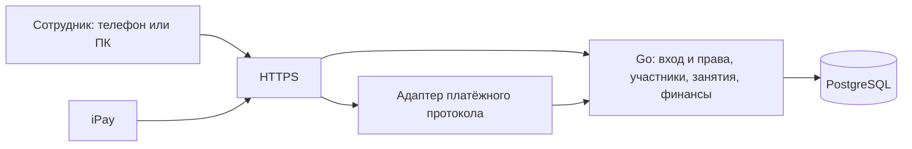

# Первая версия CRM PRIDE: архитектура для обсуждения

Дата: 11.10.2026. Статус: **черновик предложений**, не утверждённая архитектура. Заказчик явно указал сейчас ничего не реализовывать. Код, миграции, инфраструктура и интеграция не создавались.

## Подтверждённая основа

Источник — два раунда ответов заказчика. Полная запись: [контекст CRM](knowledge-base/crm-context.md), краткая — [память](knowledge-base/memory.md).

- React, Go, PostgreSQL; VPS, Docker Compose; устанавливаемое PWA.
- Закрытая первая версия для сотрудников сразу на весь клуб. Каждый зал Гомеля — отдельный клуб с администратором. Владелец сразу имеет общий доступ; детальный объём статистики ещё определить.
- Начальный перенос участников из Excel. Администратор создаёт карточки: ФИО, дата рождения, контакт родителя/взрослого участника, группа.
- Администратор формирует группы и регулярное расписание; система создаёт конкретные занятия. Тренер отмечает присутствие, болезни, справки/освобождения; долги ему не нужны.
- Отмена занятия, замена тренера и изменение прошлых отметок доступны администратору.
- Месячный взнос задаётся участнику вручную, повторяется и меняется с выбранного месяца. Корректировку при болезни делает администратор. Оплата — через ЕРИП; нужна интеграция iPay.
- Везде полноценная мобильная адаптация; тренер преимущественно на телефоне, администратор и владелец на ПК. Офлайн-очередь не требуется.
- Личные кабинеты участников, запись и аренда экипировки — позже. Бизнес-логика посещений другой группы — отдельное последующее обсуждение.

## Предложение по устройству приложения

Один Go-сервис с внутренними модулями, одно React-приложение и одна PostgreSQL. Отдельный адаптер iPay внутри сервиса; модуль не является отдельным микросервисом. Простой развёртываемый комплект Docker Compose: входной HTTPS-прокси, приложение, база. Сборку интерфейса можно отдавать из Go-сервиса, чтобы не вводить отдельный сервер интерфейса.

Приватность определяется входом и серверными правами. Для ON-LINE потребуется доступный iPay обработчик запросов, защищённый согласованным механизмом провайдера; это не открывает сотрудническую часть посторонним. PWA остаётся устанавливаемым интерфейсом с обычной онлайн-работой, без очереди изменений.

## Минимальные области данных

Названия ниже — предложения предметной модели, не финальная схема таблиц.

| Область | Что хранить и зачем |
| --- | --- |
| Клубы | Каждый зал как единица доступа администратора; название, адрес, состояние |
| Сотрудники и назначения | Вход отдельно от участника; роль владельца, доступ администратора к клубу, тренера к назначенным группам |
| Участники | Единая внутренняя карточка и отдельный постоянный ID; ФИО, дата рождения, контакт. Учётные записи родителей сейчас не создавать |
| Принадлежность участника | Связь с клубом и группой с датами начала/окончания; история без копирования карточки при изменении группы |
| Группы и расписание | Название, клуб, тренер; регулярные дни/время с датой начала действия |
| Занятия | Конкретная дата/время, группа и фактический тренер, состояние занятия; отмена и замена не уничтожают историю |
| Посещаемость | Одна отметка на участника и занятие; присутствовал / болел / отсутствовал. Отдельное «не отмечен» до заполнения — предложение |
| Справки и освобождения | Отдельные записи для медицинского допуска и болезни; начало срока, период освобождения. Конечная дата допуска ещё уточняется; диагнозы/сканы не запрошены |
| История взноса | Сумма участника, месяц начала действия; новое значение не переписывает предыдущие месяцы |
| Начисления и корректировки | Обязательство за конкретный месяц, исходная сумма, корректировка администратором с причиной |
| Платежи и зачёт | Платёж провайдера отдельно от начисления; распределение суммы по обязательствам. Очередность периодов и предоплата ещё не согласованы |
| Привязки iPay | Услуга и PersonalAccount отдельно от внутреннего ID; связь с клубом и плательщиком/участником по согласованному сценарию |
| История операций | Кто и когда изменил прошлую отметку, цену, начисление, справку или состав группы; минимум, нужный для разбора ошибок |

Будущие кабинеты смогут ссылаться на уже существующие карточки участников. Подробные модели бронирования и аренды сейчас не проектировать. Единая карточка и история принадлежности не утверждают правила оплаты разовых посещений чужой группы.

## Минимальные правила целостности

Это инженерные предложения, которые защищают подтверждённые процессы:

1. Права проверять сервером: администратор ограничен своим клубом; тренер не получает финансовые сведения даже через прямой запрос API. Владелец имеет общий доступ. Точные назначения и доступ к медицинским сведениям согласовать отдельно.
2. Расписание и конкретное занятие разделить. Изменение будущего расписания не переписывает историю. Генерация занятий повторяется безопасно, без дубликатов.
3. Пересоздание месячных начислений не начисляет повторно. Изменение взноса с месяца формирует новую версию, а исправление уже выставленной суммы оставляет историю. Начало/остановка начисления и правила пересчёта ещё согласовать.
4. Суммы хранить точно, например в копейках; граница протокола преобразует в формат iPay с запятой. Не рассчитывать долг только по текущей цене и количеству посещений.
5. Архивирование участника/группы предпочтительнее физического удаления связанных посещений и финансов. Как прекращаются начисления при выбытии, ещё решить.
6. Справка фиксирует период болезни, но сама по себе не уменьшает взнос: сумму меняет администратор. Автозаполнение отметок по справке пока не утверждено.
7. Импорт сначала показывает найденные записи и возможные дубли для проверки. Совпадение ФИО или семейного телефона не доказывает одну личность. Год рождения из табеля не превращать в выдуманную полную дату рождения; неполные данные перед стартом согласовать.
8. При недоступном интернете показывать состояние ошибки; не считать отметку сохранённой до подтверждения сервера. Кеширование чувствительных данных не является необходимостью первой версии.

## Платёжный поток

По [разбору присланного PDF](knowledge-base/ipay-protocol.md) iPay отправляет запросы на сервер поставщика. Предлагаемый сценарий: администратор создаёт/корректирует месячное начисление в CRM; при вводе лицевого счёта iPay запрашивает сумму через ServiceInfo, CRM возвращает рассчитанный остаток. Разрешение родителю менять сумму и выбор периода пока не определены.

TransactionStart регистрирует попытку оплаты. Успешный TransactionResult подтверждает платёж; повторная доставка не должна повторно гасить долг. Сумма известна из сохранённого TransactionStart, а не из результата или актуального взноса. StornStart/StornResult нужны для отдельной обработки сторнирования. HTTP 200 означает доставку, а не факт оплаты.

Для простоты внутреннее выполнение ежемесячных начислений/генерации занятий может находиться в том же Go-сервисе. Не добавлять отдельный брокер/очередь как исходное условие. Сохранение платёжных событий, повторяемость обработки и сверку не исключать ради простоты CRUD.

Присланный документ не задаёт API чтения истории платежей, исходящего создания счёта или инициирования возврата. Подключение требует подтверждения редакции, кода услуги, лицевых счетов, транспорта, подписи, повторов и тестового доступа. Эти неизвестные не заменять имитацией интеграции.

## Что согласовать дальше

- Начислять с какого месяца при вступлении и как останавливать взносы при уходе/паузе; переносить ли начальные долги/предоплаты из Excel.
- Предлагать в ЕРИП сумму за текущий месяц или общий остаток долга; разрешать ли менять сумму, частичные оплаты и предоплату; как распределять деньги по периодам.
- Какой срок хранить для общего медицинского допуска, кто завершает журнал занятия и превращает неотмеченных в отсутствовавших.
- Назначения тренеров/администраторов в нескольких клубах, создание сотрудников владельцем и объём статистики первой версии.
- Структура реального Excel, неполные даты рождения, пробные участники и архивирование.

Предложения по реализации необходимо обсуждать с заказчиком; этот документ не меняет его запрет на текущую реализацию.
