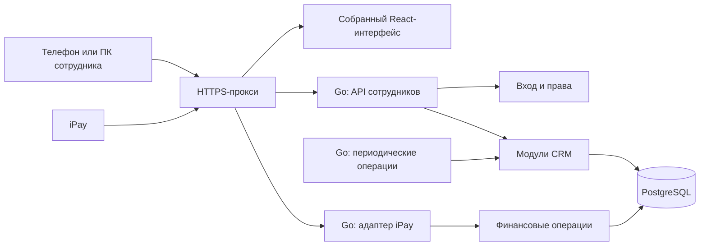

# Архитектура JudeOSLite v1

Версия: 1.3. Дата: 11.10.2026. Назначение: основа подробного плана разработки CRM сети PRIDE. Приложение, миграции и развёртывание сейчас не реализуются. Версия 1.3 включает ответы перед составлением плана и приоритет быстрого получения первой работающей версии.

**Статус:** требования заказчика подтверждены; устройство приложения и схема БД — инженерное предложение. Открытые условия B01–B10 не считаются решёнными по умолчанию. Заказчик поручил подготовить архитектуру, структуру/описание/визуальное представление БД и промпт планирующего агента.

## 1. Карта контекста

| Документ | Назначение |
| --- | --- |
| [AGENTS.md](../AGENTS.md) | Правила памяти, коммита и push только файлов задачи |
| [Указатель базы](knowledge-base/README.md), [память](knowledge-base/memory.md) | Решения и ограничения |
| [Контекст CRM](knowledge-base/crm-context.md) | Ответы заказчика и текущий Excel-процесс |
| [Клуб](knowledge-base/club.md), [реестр источников](knowledge-base/site-inventory.md) | Публичные сведения, происхождение, противоречия |
| [iPay](knowledge-base/ipay.md), [протокол](knowledge-base/ipay-protocol.md) | Обмен и неизвестные условия подключения |
| [Схема БД](database/schema-v1.md), [диаграммы](database/diagrams-v1.md) | Поля, связи, ограничения, процессы |
| [DESIGN.md](../DESIGN.md), [дизайн-система](../design-system/README.md) | Оформление и ресурсы |
| [План реализации](development-plan-v1.md) | Первый рабочий срез, небольшие задачи, граф зависимостей и контрольные точки |
| [Промпт планировщика](planning-agent-prompt.md) | Требования к подробному плану небольших работ |

Сведения сайта — датированный контекст, не рабочие тарифы. При конфликте фиксировать источник и опираться на прямой ответ заказчика. Старый PDF iPay не является автоматически действующим договорным протоколом.

## 2. Требования и границы

<a id="requirements"></a>
### 2.1 Подтверждённые требования R01–R12

| ID | Требование |
| --- | --- |
| R01 | React, Go, PostgreSQL; VPS и Docker Compose |
| R02 | Закрытая система сотрудников; каждый зал Гомеля — отдельный клуб с администратором |
| R03 | Владелец с общим доступом сразу в v1; обзор участников, посещаемости, начислений, оплаты и задолженности по клубам/месяцам; формулы уточняются |
| R04 | Общий реестр, начальный перенос из Excel; новые карточки создаёт администратор |
| R05 | Минимум карточки: ФИО, дата рождения, контакт родителя/взрослого участника, группа |
| R06 | Администратор управляет составом групп и регулярным расписанием; система создаёт занятия |
| R07 | Тренер отмечает присутствие, болезни, справки/освобождения; не видит долги |
| R08 | Администратор отменяет занятия, заменяет тренера и исправляет прошлые отметки |
| R09 | Администратор задаёт месячный взнос участнику; повторение, изменение с выбранного месяца |
| R10 | Корректировка при болезни — вручную администратором; болезнь с периодом учитывается отдельно |
| R11 | Контроль ЕРИП через iPay и выставление взносов участникам |
| R12 | Mobile-first, устанавливаемое PWA, адаптация всех ролей; офлайн-очередь не нужна |

Excel: «п» — присутствовал, «б» — болел, красная пустая клетка — отсутствие; дата справки — начало срока. Значение «б/о» неизвестно, его не превращать в финансовую льготу.

### 2.2 Вне v1

Кабинеты участников/родителей, самостоятельная запись, аренда экипировки, мессенджеры, push, автоматические льготные формулы, бухгалтерская система, диагнозы/сканы и офлайн-синхронизация. Разовые посещения чужой группы и их тарификацию заказчик отложил. История принадлежности группам не задаёт эту бизнес-логику. Прогноз роста сейчас не прорабатывается; небольшие функции добавляются последовательно.

## 3. Архитектурные предложения P01–P08

**Приоритет заказчика от 11.10.2026:** существенно не усложнять backend, сохранить фундамент для масштабирования и быстро получить первую работающую версию. Предлагаемый первый рабочий срез: вход и клубные права → реестр/группы → сегодняшнее занятие и мобильная посещаемость. Это порядок внутри v1, не исключение взносов/iPay. Таблицы и модули добавлять по потребности, без универсального CRUD, брокера и отдельных сервисов.

| ID | Решение для обсуждения и причина |
| --- | --- |
| P01 | Модульный монолит: один Go-процесс, одно React-приложение, одна PostgreSQL; простой запуск и транзакции |
| P02 | Один HTTPS-origin для UI/JSON API; отдельный обработчик XML iPay с собственной аутентификацией |
| P03 | Серверные права по клубу/группе; отсутствие финансовых полей в DTO тренера |
| P04 | Единая идентичность участника; отдельные принадлежность, контакты, справки и финансы по клубу |
| P05 | Датированная история групп, расписаний и цен; архивирование связанных сущностей |
| P06 | Повторяемая генерация занятий/начислений внутри сервиса; защита от дублей в БД |
| P07 | Платёжный модуль со состояниями попыток, сохранёнными событиями, зачётом и сторно |
| P08 | Явные SQL и небольшие границы БД/провайдера/времени; без универсального конструктора CRM |

<a id="components"></a>
### 3.1 Компоненты



Предполагаются три контейнера: HTTPS-прокси, приложение и БД. Go отдаёт собранный frontend; при разработке отдельный frontend-сервер проксирует API. PostgreSQL не публикуется наружу. Приватность сотруднической части обеспечивается входом и правами; доступный iPay endpoint защищается договорным механизмом провайдера.

### 3.2 Технологический минимум

Предложение: React + TypeScript + Vite; Go `net/http`, pgx, явные SQL; нумерованные миграции с одним runner. Один набор UI-компонентов на токенах PRIDE. Библиотеки/версии фиксировать в подготовительном этапе после проверки актуальных первичных источников. Нет необходимости выбирать ORM, генератор CRUD, отдельный брокер или аналитическую платформу.

Вход сотрудников — серверные сессии в БД, парольный хеш проверенной библиотекой; без регистрации родителей. Jobs запускаются при старте и периодически; повторный запуск не дублирует результат. PWA устанавливается; service worker кеширует только версионированную статику оболочки. Ответы API сотрудников и данные участников/финансов/справок не помещаются в Cache Storage, изменения не накапливаются офлайн.

### 3.3 Будущая структура репозитория

```text
README.md / AGENTS.md / DESIGN.md
design-system/                 токены, шрифты, ресурсы
docs/                          архитектура, схема, контекст, план
backend/
  cmd/server/                  запуск, конфигурация, остановка
  internal/auth/               сотрудники, сессии, права
  internal/clubs/              клубы и назначения
  internal/participants/       карточки, принадлежность, импорт
  internal/training/           группы, расписание, занятия, отметки
  internal/medical/            допуск и освобождения
  internal/billing/            цены, начисления, корректировки
  internal/payments/           попытки, платежи, зачёт, сторно
  internal/ipay/               XML, кодировка, доверие провайдеру
  internal/audit/              история значимых изменений
  internal/platform/           БД, HTTP-ошибки, часы, jobs
  migrations/                  SQL-миграции
frontend/
  src/app/                     маршруты, вход, оболочка
  src/features/                предметные страницы
  src/shared/                  поля, списки, API-клиент
deploy/                        Compose, HTTPS, backup, инструкции
```

Это карта для планирования; каталоги кода сейчас не создаются. Финансовая логика живёт в сервисных операциях payments/billing, а не повторяется внутри iPay/UI. Общая инфраструктура не становится универсальным repository/controller.

<a id="access"></a>
## 4. Доступ и данные

`Да` основано на ответах, `P` — предложение, `Нет` — граница v1.

| Действие | Тренер | Администратор | Владелец |
| --- | --- | --- | --- |
| Просмотр клуба | По назначениям | Свой клуб | Все клубы |
| Просмотр участников | Назначенные группы/занятия | Свой клуб | Все клубы |
| Создание участника/состава группы | Нет | Да | Все клубы |
| Расписание | Нет | Да | Все клубы |
| Текущие отметки | До завершения | Свой клуб | Все клубы |
| Прошлые/закрытые отметки | Нет | По одной с причиной, без ограничения давности | Все клубы, те же требования |
| Справки/болезни | Назначенные группы/занятия | Свой клуб | Все клубы |
| Отмена/замена тренера | Нет | Да | Все клубы |
| Финансы | Нет | Свой клуб | Все клубы |
| Сотрудники/назначения | Нет | Создаёт тренеров своего клуба; прочие операции по B05 | Управляет всеми клубами/сотрудниками |
| Обзор сети | Нет | Нет | Участники, посещаемость, начислено, оплачено, задолженность; формулы по B06 |

Источник уточнения матрицы: ответы заказчика 11.10.2026. Несколько клубных/групповых назначений одному сотруднику разрешены. Из права создавать тренеров своего клуба не следует право выдавать owner/administrator или менять доступ другого клуба.

Сервер получает пользователя и допустимые клубы; присланный `club_id` не доказывает доступ. Ограничения распространяются на чтение, запись, поиск, экспорт и счётчики. Тренеру не возвращаются финансовые DTO даже через прямой API-запрос.

Единая карточка не открывает данные другого клуба. Контакт хранится в принадлежности клубу. Сопоставление межклубных дублей — предложенная функция владельца; автоматическое объединение по имени/телефону недопустимо. Общую идентификацию участника нескольких клубов предлагается редактировать владельцу; B05.

Браузер использует cookie сессии с Secure/HttpOnly и согласованным SameSite, изменения — CSRF-защиту. Вход ограничивается по частоте попыток; выход/отключение сотрудника отзывает доступ. Параметры cookie сверить с [MDN Set-Cookie](https://developer.mozilla.org/en-US/docs/Web/HTTP/Reference/Headers/Set-Cookie). Секреты и медицинские payload не писать в логи.

## 5. Предметные сценарии

<a id="participants"></a>
### 5.1 Реестр и импорт

Создание карточки, связи клубу и начальной группе — одна транзакция. Смена группы закрывает прежний интервал и создаёт новый; прошлые занятия не меняются. Архивирование сохраняет историю и долг. Администратор выбирает месяц остановки и возобновления начислений (ответ 11.10.2026); статус/дата архивирования не подменяют этот выбор.

Импорт Excel: загрузка → предпросмотр → ошибки/сопоставление → подтверждение → итог batch. Повтор применения batch не создаёт дубли. Заказчик разрешил импорт только года рождения (11.10.2026); новая форма требует полную дату. Не придумывать 01.01, не считать семейный телефон уникальным. Совпадения разбираются вручную; неизвестное «б/о» автоматически не преобразуется. Реальный формат и начальные остатки согласуются перед пробным импортом и переходом к автоматизации — B01/B08; не создавать реальные профили из публичных ФИО тренеров.

<a id="training"></a>
### 5.2 Расписание и занятия

Расписание — регулярное правило; занятие — дата, время и фактический тренер. Период действия правила задан явно; версии одного пункта сохраняют series_key. Генератор создаёт ограниченный горизонт; предложение — текущий и следующий месяц. Повтор безопасен, проверяет исходную дату и стабильный ключ, учитывает отменённые/перенесённые занятия. Изменение будущего правила не переписывает прошлые и вручную изменённые занятия. Перенос обычных будущих planned-занятий выполняется явной операцией обновления расписания под блокировкой группы.

Предлагаемые состояния: `planned → open → closed`, отдельно `cancelled`. Открытие сохраняет состав по датированным принадлежностям группы на день занятия. После открытия это снимок; изменение сегодняшнего состава не меняет старый журнал. Поправка снимка — администратор с причиной.

Отметка сначала `unmarked`; затем присутствовал/болел/отсутствовал. Итоговый ответ заказчика от 11.10.2026: журнал завершает тренер, неотмеченные участники не препятствуют завершению и получают «Отсутствует — причина неизвестна». Тренер исправляет отметки до завершения; после — администратор по одной с обязательной причиной, без ограничения давности. Предложение: завершение, автоматические отметки и аудит выполняются одной транзакцией; повтор безопасен. Повторное открытие не согласовано и не требуется для административной правки. Отмена занятия не создаёт отсутствия всех участников. На мобильном UI подтверждает сохранение только после ответа сервера.

<a id="attendance-mobile"></a>
#### Мобильные карточки тренера

Источник: запрос заказчика о карточках «а-ля Tinder» и ответы на три вопроса о посещаемости от 11.10.2026.

**Подтверждено:** участники выбранной группы/занятия показываются последовательными карточками; отметка выполняется только кнопками с переходом к следующей карточке, без свайпов. Два действия — присутствие и отсутствие; отсутствие открывает выбор причины: неизвестна / болезнь до учёта справки / уважительная. Справка хранится отдельно; отметки исправляются по одной, без автоматического или пакетного изменения за период справки. Исправление прошлых/закрытых отметок — администратор с причиной, без ограничения давности. При завершении неотмеченные получают отсутствие с неизвестной причиной. Последний ответ заменяет предложение хранить их отдельно после завершения.

**Предложения интерфейса, ещё не подтверждённые:** подписи «Присутствует» / «Отсутствует», панель выбора причины снизу экрана, сохранение сразу после выбора причины, закрытие панели без изменения отметки, прогресс, «Пропустить пока», возврат к предыдущей карточке и итоговый список. Фотографии не становятся обязательным полем реестра.

**Инженерное уточнение, не новый бизнес-ответ:** T12 дополнена отдельной absence_reason; вариант «Болезнь» отображается как sick + illness, неизвестная/уважительная причина — absent + unknown/excused. До миграций проверить этот контракт в плане; change_reason остаётся объяснением административного исправления. «Болезнь» в карточке сама по себе не создаёт справку или период освобождения и не корректирует деньги. Автозаполнение будущих занятий по справке не входит в выбранный минимальный сценарий.

<a id="medical"></a>
### 5.3 Справки

Два вида: допуск и болезнь. По ответу заказчика 11.10.2026 начало обязательно, окончание у обоих видов может быть неизвестно. Неизвестное окончание показывается явно и не выдаётся за подтверждённый бессрочный допуск. Данные ограничены клубом; диагнозы/сканы не требуются. Тренер регистрирует сведения и видит периоды на занятии. Справка хранится отдельно; автоматического или пакетного изменения отметок по справке в минимальном сценарии нет.

Болезнь не меняет деньги: администратор создаёт корректировку начисления с основанием и при необходимости ссылкой на болезнь. Исправление справки не переписывает платежи.

<a id="billing"></a>
### 5.4 Месячные взносы

Цена принадлежит участнику в клубе. `fee_terms` хранит интервалы по месяцам: при новой цене с ноября старый интервал заканчивается перед ноябрём, новый начинается в ноябре. Октябрь сохраняет свою сумму.

Генератор создаёт одно обычное начисление на связь участник–клуб/месяц, сохраняет снимок цены. Повтор не меняет существующее начисление. Нулевой взнос допустим; это не отсутствие участника. Исправление выставленного месяца — отдельная корректировка с историей и защитой от повтора. Подтверждено 11.10.2026: сумму неполного месяца при вступлении/уходе вручную задаёт администратор; автоматическая пропорция или полный месяц не обязательны. Представление через исходное начисление и корректировку — предложение для контракта. Месяц остановки/возобновления начислений выбирает администратор. Предложение: закрытие/возобновление ценового интервала управляет будущей генерацией, уже выставленное изменяется корректировкой. Начальные остатки — B01.

Не выводить оплату из пропусков и не переносить тариф сайта. Срок до 7-го опубликован, но применение и точная просрочка в CRM требуют B03.

<a id="ipay"></a>
### 5.5 Платежи и iPay

Разделять цену, начисление, корректировку, успешный платёж и зачёт по начислениям. Баланс вычисляется; администратор не ставит «оплачено» без источника. Предлагаемое выставление: создать начисление в CRM и отдавать сумму при ServiceInfo. PDF не описывает отдельный исходящий API создания счета.

**Подтверждено заказчиком 11.10.2026:** желаемая сумма в ЕРИП — только неоплаченная сумма текущего месяца. Первая версия предусматривает точную оплату выставленной суммы; частичная оплата и предоплата не являются обычными пользовательскими сценариями. Возможность запретить изменение суммы и связать платёж с конкретным начислением проверяется по действующему договору/протоколу iPay (B07). Не распределять автоматически оплату текущего месяца на старые долги. Способ оплаты прошлых месяцев, срок/просрочка, изменение начисления во время попытки оплаты и обработка фактически полученной суммы, отличной от выставленной, остаются B03. Не терять подтверждённое провайдером поступление из-за ограничения обычного сценария; безопасный разбор исключений и сумм после корректировки ещё нужно согласовать.

<a id="payment-transition"></a>
**Обязательная точка возврата, поручение заказчика 11.10.2026:** перед платёжными тестами снова обсудить старые долги и последовательный переход к формированию оплат через CRM. До пробного импорта согласовать Excel и начальные остатки. До включения рабочего расчёта сумм проверить стенд, сверку и дату переключения без двойного начисления/зачёта. Эти условия не блокируют первый срез посещаемости, но блокируют реальный переход; синтетический адаптер не является рабочей интеграцией.

| Событие | Действие |
| --- | --- |
| ServiceInfo | Проверить услугу/счёт, прочитать сумму; не платёж |
| TransactionStart | Сохранить попытку, сумму и свой ID; не гасить долг |
| TransactionResult без ErrorText | Один раз подтвердить сохранённую попытку и успешный платёж |
| TransactionResult с ErrorText | Сохранить неуспех, не создавать успешный платёж |
| StornStart | Запрос сторно; не удалить платёж |
| StornResult с Storned=Y | Подтвердить сторно и обратные записи зачёта одной транзакцией |
| Повтор/конфликт/неизвестная цепочка | Без второго финансового эффекта; при конфликте отдельный разбор |

Суммы нет в TransactionResult: брать из сохранённого TransactionStart. HTTP 200 — доставка, не факт оплаты. Хранить целые копейки; адаптер преобразует формат. Комиссия не создаёт долг участнику; банковское зачисление отдельно от факта его платежа.

Проверка подписи/источника предшествует изменениям. Корректное событие сохраняется до ACK. В ответе TransactionResult источник запрещает XML Error; не подменять этим восстановление/разбор зачёта. Результат без начала остаётся неразобранным, не вычислять сумму по сегодняшней цене. Противоречия не перезаписывают предыдущий успех. Модель предусматривает полное сторно; частичное и точные ID — B07.

Состояния настройки: не настроена / тестовая / рабочая. Показывать свежесть обмена и неразобранные операции. PDF не задаёт получение реестра; реальная интеграция и сверка ждут B07. Тестовый адаптер и экран фактов не выдаются за рабочее подключение.

<a id="interface"></a>
## 6. Интерфейс и HTTP-контракты

### 6.1 Экраны

| Раздел | Минимальный результат |
| --- | --- |
| Вход | Вход, ошибка, выход, истечение сессии |
| Клубы/сотрудники | Выбор клуба владельцем и назначения по B05 |
| Участники | Поиск/группа/состояние; карточка, история и архивирование |
| Группы | Состав, тренеры, регулярное расписание, занятия |
| Сегодня | Последовательные карточки участников у тренера на телефоне; кнопки без свайпов, выбор причины отсутствия; без финансов |
| Журнал | Период/группа, даты и итог; мобильный список выбранного занятия |
| Справки | Допуск отдельно от болезни; период и ответственный |
| Взносы | Цена с месяца, начисления, корректировки, остаток/платежи |
| iPay | Настройка, счета, свежесть обмена, неразобранные операции |
| Импорт | Предпросмотр, ошибки, сопоставление, подтверждение batch |
| Обзор владельца | Все клубы; показатели и формулы по B06 |

Переиспользовать [tokens.css](../design-system/tokens.css), [fonts.css](../design-system/fonts/fonts.css), [manifest.json](../design-system/manifest.json), правила [DESIGN.md](../DESIGN.md) и [дизайн-системы](../design-system/README.md). Служебные экраны не повторяют рекламную главную. На ПК — таблицы, на телефоне — читаемые списки и формы. Основной мобильный текст 16 px, зоны нажатия от 44 px, видимый фокус; цвет дополняется названием состояния. Для большой матрицы допустим локальный scroll, отметка занятия доступна обычным списком.

Формы имеют loading/empty/error/success, поля с подписями и ошибками, защиту от повторной отправки. Финансовые данные отражают свежесть и источник. Изменения, ожидающие ответа, не показываются как надёжно сохранённые.

<a id="contracts"></a>
### 6.2 Группы контрактов

Операции здесь — предложение, не готовая OpenAPI. В плане контракт каждой операции выделяется отдельно.

| Путь | Операции и границы |
| --- | --- |
| `/api/v1/auth` | login/logout/me, сессии и CSRF |
| `/api/v1/clubs`, `/staff` | доступные клубы, сотрудники/назначения |
| `/api/v1/clubs/{clubId}/participants` | карточки, архивирование, история группы |
| `/api/v1/clubs/{clubId}/groups` | группы, тренеры, расписание с датами |
| `/api/v1/clubs/{clubId}/sessions` | список, открытие/закрытие/отмена/замена |
| `/api/v1/.../sessions/{id}/attendance` | отметки с version и проверкой доступа |
| `/api/v1/.../memberships/{id}/medical-records` | вид/период в своём клубе |
| `/api/v1/.../memberships/{id}/fee-terms` | интервалы месячной цены |
| `/api/v1/.../charges`, `/payments` | начисления, корректировки, зачёт; запрет тренеру |
| `/api/v1/.../imports` | предпросмотр/сопоставление/применение batch |
| `/api/v1/owner/overview` | согласованные агрегаты B06 |
| `/integrations/ipay/{routeKey}` | договорный XML POST, отдельная аутентификация |

JSON API: коды ошибок/сообщения/поля, стабильная сортировка и ограниченная пагинация; 401/403/404/409 по контракту. Ошибка чужого ресурса не раскрывает его данные. Обычные изменения защищены version от потери параллельной правки; финансовые POST и импорт — request_key. XML-ошибки iPay не копируют внутренний JSON-контракт.

<a id="operations"></a>
## 7. Эксплуатация и проверка

Секреты — окружение/секреты VPS, примеры содержат только имена параметров. Версии зависимостей/контейнеров фиксируются при реализации. Миграции запускает один runner перед обновлением. План включает readiness БД, liveness, остановку, HTTP-таймауты/лимиты и логи без персональных payload. Backup, место/срок хранения и проверка restore — отдельные небольшие задачи.

Проверки по риску: чужой клуб/финансы тренеру; повтор jobs; цена с месяца; корректировка после платежа; повтор/конфликт iPay; сторно; повтор импорта; исторический состав группы. Ограничения БД проверяются в настоящей тестовой PostgreSQL. UI — мобильный/ПК для каждой роли, клавиатура, пустые состояния и ошибки сети. Синтетические тесты протокола не заменяют стенд iPay. Реальные реестры/credentials не помещаются в Git.

<a id="decisions"></a>
## 8. Открытые решения B01–B10

| ID | Что не подтверждено | Независимая подготовка | Что ждёт решения |
| --- | --- | --- | --- |
| B01 | Частично решено: сумму неполного месяца при вступлении/уходе задаёт администратор. Не решены дата старта и начальные остатки | Модель интервалов, ручной суммы, предпросмотр | Реальные начальные остатки/начисления |
| B02 | Решено: месяц остановки/возобновления выбирает администратор; неполный месяц вручную | История и интервалы цены | Уже выставленные суммы изменять корректировкой |
| B03 | Частично решено: неоплаченная сумма текущего месяца, только точная оплата, без частичной/предоплаты. Не решены старые долги, просрочка и финансовые исключения | Модель, экран фактов, контракт точной суммы | Оплата прошлых месяцев, исключения/корректировки после оплаты; договорная реализация ServiceInfo зависит от B07 |
| B04 | Решено: тренер завершает; unmarked → отсутствие/неизвестна; тренер правит до завершения, администратор после с причиной без срока | Карточки, атомарное завершение/аудит | Повторное открытие не включать без нового требования |
| B05 | Основная матрица решена; несколько назначений, администратор создаёт своих тренеров | Клубные права, запрет финансов | Детали отключения общего аккаунта и правки общей карточки согласовать в контракте |
| B06 | Показатели решены: участники, посещаемость, начислено, оплачено, задолженность по клубам/месяцам | Простые SQL-агрегаты | Формулы и различие оплаты/зачёта явно согласовать |
| B07 | iPay: редакция, услуги/счета, подпись, ID, транспорт, повторы, частичное сторно, сверка | Модель и синтетический адаптер | Реальное подключение/ACK/восстановление |
| B08 | Год без даты, ручные совпадения и неизвестные обозначения решены; нужен реальный формат | Предпросмотр/batch | Перед пробным импортом согласовать формат и начальные остатки |
| B09 | Решено: окончание обоих видов может быть неизвестно; справка отдельно | Два вида, начало, nullable конец | Не считать неизвестный конец бессрочным допуском; без автоотметок |
| B10 | Устройства решены: iPhone/Safari, Android/Chrome; ПК Chrome/Edge | Адаптивный UI/manifest | Версии фиксируются перед реализацией и приёмкой |

Неизвестные условия не останавливают всё планирование; план явно отмечает зависимые задачи. Нельзя подменять ответ заказчика удобным предположением.

<a id="done"></a>
## 9. Достаточность первой версии

История участников/групп сохранена, клубы изолированы, повтор импорта безопасен. Тренер отмечает занятия с телефона без финансов. Болезнь имеет период, деньги корректирует администратор. Цена меняется с месяца, начисления/платежи не дублируются, баланс объясним. После B03/B07 iPay проверен на договорном стенде, повтор и сторно обработаны. Владелец имеет общий доступ и согласованную статистику. Все роли работают на мобильном/ПК; backup/restore и работа после простоя проверены.

Подготовлен [план реализации](development-plan-v1.md) по [промпту](planning-agent-prompt.md) и последующим уточнениям. Начало реализации требует отдельной команды заказчика.
