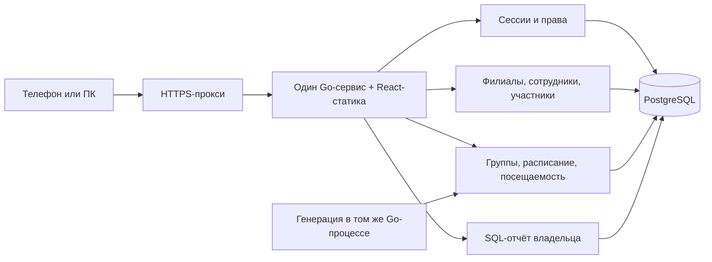

# Архитектура JudeOSLite v1

Версия 2.0, 12.10.2026. Требования заказчика отделены от инженерных предложений. Эта версия заменяет прежнюю расширенную v1 с финансами: [история](archive/README.md). Сейчас меняются документация и организация работ; приложение ещё не реализовано.

## Подтверждённые границы

Внутренняя CRM сотрудников PRIDE: React, Go, PostgreSQL; VPS/Docker Compose; mobile-first и устанавливаемое PWA. Каждый зал — отдельный филиал (в данных: club). Владелец видит сеть, администратор — свои филиалы, тренер — назначенные группы/занятия. Несколько назначений сотруднику разрешены; администратор создаёт тренеров своего филиала.

Первая версия: ручной ввод участников, группы/история состава, расписание, занятия, посещаемость, отчёт владельца. **Нет финансов, оплат, iPay, Excel-импорта и отдельного учёта справок.** Кабинеты родителей/участников, запись и аренда также позже. Болезнь остаётся причиной отсутствия без медицинского документа.

Заказчик 12.10.2026 подтвердил приоритет: быстро получить работающую версию, оставить фундамент для добавления функций/сущностей, не усложнять backend и не исходить из сильного масштабирования.

## Инженерная основа

Один Go-монолит с небольшими предметными пакетами, одно React-приложение, одна PostgreSQL. Go net/http, pgx, явные SQL и нумерованные миграции — предложение, конкретные поддерживаемые версии проверяются в V1-01. Слои только там, где нужна граница HTTP / операции / SQL; нет универсальных repository/controller, ORM, event sourcing, брокера, CQRS и микросервисов.

Развиваемость обеспечивают устойчивые ID, club_id и серверные права, миграции, история состава/расписания и операций, обычные транзакции. Будущие billing/medical/ipay добавляются по отдельной согласованной задаче. Пустые пакеты, таблицы, endpoint-заглушки и абстракции «на будущее» сейчас не нужны.



Production: proxy/app/db, один HTTPS-origin. БД наружу не публикуется. В разработке Vite проксирует API. Периодическая генерация в процессе Go, без отдельного job-сервиса; уникальные ограничения и транзакции делают повтор безопасным.

Предлагаемая структура создаётся по мере работы:

```text
backend/cmd/server
backend/internal/{auth,clubs,participants,training,reports,platform}
backend/migrations
frontend/src/{app,features,shared}
deploy
docs
```

Это ориентир, а не требование заранее создать все папки.

<a id="access"></a>
## Доступ

| Операция | Владелец | Администратор | Тренер |
| --- | --- | --- | --- |
| Филиалы/назначения администраторов | Вся сеть | Нет | Нет |
| Тренеры | Вся сеть | Создание и локальное назначение своего филиала | Нет |
| Реестр/группы/расписание/отмена/замена | Вся сеть | Свои филиалы | Просмотр назначенного |
| Отметки своего занятия до закрытия | Да | Да в своём филиале | Фактический назначенный тренер |
| Исправление после закрытия | По одной с причиной | По одной с причиной, свой филиал | Нет |
| Статистика сети | Да | Нет | Нет |

Предложение для общего аккаунта: администратор управляет локальным назначением тренера; логин/пароль/отключение общего аккаунта нескольких филиалов меняет владелец. Создание admin/owner запрещено администратору. Несколько ролей складывают разрешения в пределах назначений.

Назначенная группа для тренера определяется правилами расписания и фактическими занятиями; для записи решает фактический тренер конкретного сеанса. Отдельный универсальный конструктор групповых разрешений не нужен.

Каждый API проверяет сотрудника, текущие роли и допустимый филиал; club_id из клиента не является разрешением. Фильтры, поиск, счётчики и сообщения ошибок также не раскрывают чужие данные.

Предложение: серверные сессии с хешем случайного токена, Secure/HttpOnly cookie, CSRF-защита, срок/отзыв, ограничение входа. Отключение/отзыв роли действует сразу. Создание владельца административной командой; нет публичной регистрации или отправки реальных паролей в Git/issues.

<a id="participants"></a>
## Участники и состав

ФИО, полная дата рождения, контакт родителя/взрослого, филиал, группа. Ручной ввод, поиск, редактирование и архив. Семейный телефон не уникален; автоматического объединения однофамильцев нет.

Предложение: participants — идентичность, club_memberships — локальный контакт/статус. Администратор редактирует общую идентичность только при единственной связи с его филиалом; общую карточку нескольких филиалов меняет владелец. UI автоматического сопоставления/слияния в v1 не нужен.

Состав группы датирован: [valid_from, valid_until), NULL конец открыт. Перевод атомарно закрывает старый период и создаёт новый. Не вводить автоматически гостевые посещения или оплату нескольких групп. Архив сохраняет ссылки и историю; открытый журнал использует свой снимок.

<a id="training"></a>
## Расписание и занятие

Подтверждены четыре режима: выбранные дни недели; чётные/нечётные даты; выбранные даты в календаре; разовое занятие. Администратор выбирает группу и тренера из списка своего филиала.

Явные предложения: чётность числа дня месяца, отдельные режимы без произвольных комбинаций, начало/необязательный конец регулярного периода, локальная зона Europe/Minsk. Weekly/parity генерируют текущий и следующий месяц; выбранные даты создаются все как конечный список, разовый сеанс не требует правила.

Изменение правила с выбранной даты создаёт новую датированную версию; обновляются только будущие обычные неоткрытые занятия. Отмены и ручные замены не затираются. Предпросмотр изменений до сохранения; прошлые/открытые/закрытые журналы неизменны. Дубликаты группы в одно время отвергаются.

training_sessions: planned → open → closed; planned/open могут стать cancelled. Отмена открытого журнала предупреждает о последствиях, сохраняет снимок/аудит и запрещает запись. Отмена закрытого сеанса в v1 не предусмотрена; cancelled исключён из статистики и не порождает отсутствия.

При первом открытии фиксируется состав на локальную дату занятия. Смена группы/архив после открытия не меняет снимок. Права проверяются и при открытии, и при каждом изменении.

<a id="attendance-mobile"></a>
## Посещаемость на телефоне

Только последовательные карточки и кнопки «Присутствует» / «Отсутствует», без свайпов. Присутствие сохраняется, затем следующая карточка. Отсутствие открывает адаптированную нижнюю панель (предложение UX) с «Неизвестна», «Болезнь», «Уважительная». Отмена панели ничего не записывает. Переход только после подтверждения сервера; крупные цели, safe area, доступный фокус.

Сводка и возврат к предыдущим отметкам до закрытия — UX-предложение. Явное завершение разрешено с неотмеченными; предупреждение показывает их число. В одной транзакции все остатки становятся absent/unknown и журнал закрывается. В истории отличать ручную отметку и автоматическое отсутствие.

Тренер исправляет до завершения; после — администратор по одной, с обязательной причиной исправления, без ограничения давности. absence_reason — причина отсутствия, change_reason — объяснение правки; это разные поля. Справки не создают автоматических изменений и сейчас не учитываются отдельно.

Открытие/отметка/закрытие/отмена/замена блокируют строку сеанса: гонки дают однозначный результат. Повтор идентичной отметки/закрытия безопасен. Версии для поштучной правки предотвращают тихую перезапись; аудит записывается атомарно.

Связь нужна: без офлайн-очереди. При ошибке нет ложного сохранения или перехода; после перезагрузки загружается серверный журнал.

<a id="reports"></a>
## Отчёт владельца

Подтверждено 12.10.2026: фильтры филиал, группа, период; число проведённых занятий, присутствий и пропусков, причины пропусков и процент посещаемости.

Процент = present / (present + absent) × 100 по закрытым занятиям. Отменённые исключаются, незавершённые показываются отдельно. Занятия считать отдельно от отметок; закрытый пустой сеанс учитывается как занятие. При нулевом знаменателе показывать «—». Период по локальной дате занятия, даты UI включительны; API использует явно документированные границы. Округление только для отображения.

SQL использует актуальные исправленные отметки и снимок сеанса; перевод не пересчитывает историю. Общий обзор/сравнение простыми таблицами/диаграммой; нет финансовой статистики или отдельного аналитического контура.

## PWA, проверки и эксплуатация

PWA кеширует только версионированную статику, персональные API-ответы не кешируются. Выход/смена сотрудника очищает отображаемые личные данные. Реальная установка iPhone/Safari и Android/Chrome, основные потоки также ПК Chrome/Edge.

V1-13 реализует [manifest, static-only service worker, standalone/safe area и безопасное явное обновление](pwa-v1.md). API и навигационные ответы не сохраняются; офлайн доступна только публичная build-time оболочка. Кнопка обновления блокируется до конца мутаций, другие вкладки не перезагружаются автоматически. Live сессия проверяется при каждом запуске; вход/выход синхронизируют очистку DOM между вкладками.

Локальные проверки включаются в функции; отдельные задачи проверяют права двух филиалов, реальные транзакции/гонки, четыре режима, историю/формулу и устройства. Развёртывание — HTTPS, безопасные секреты, регулярный backup и **реально проверенное восстановление**, без инфраструктуры высокой нагрузки.

## Дальнейшие функции и происхождение

Старые требования не объявлены отменёнными: они отложены и доступны в [контексте](knowledge-base/crm-context.md), [iPay](knowledge-base/ipay.md) и [истории](archive/README.md). До финансовой автоматизации получить доступ/подтвердить договор и обмен; перед будущими платёжными тестами обязательно снова обсудить долги прошлых месяцев и последовательный переход к оплатам через CRM.

План: [18 задач](development-plan-v1.md), [схема](database/schema-v1.md), [совместная работа](collaboration.md). Статусы разработки ведутся в GitHub, схема пока предложение.
