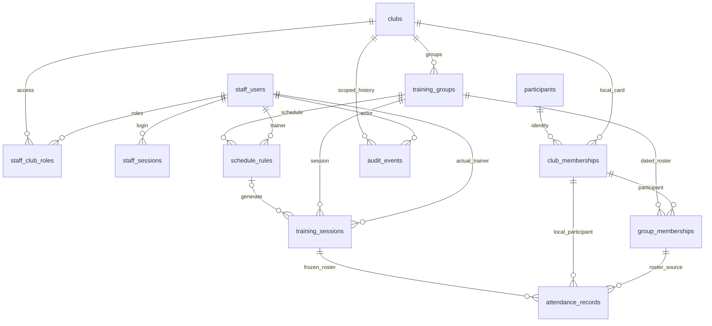
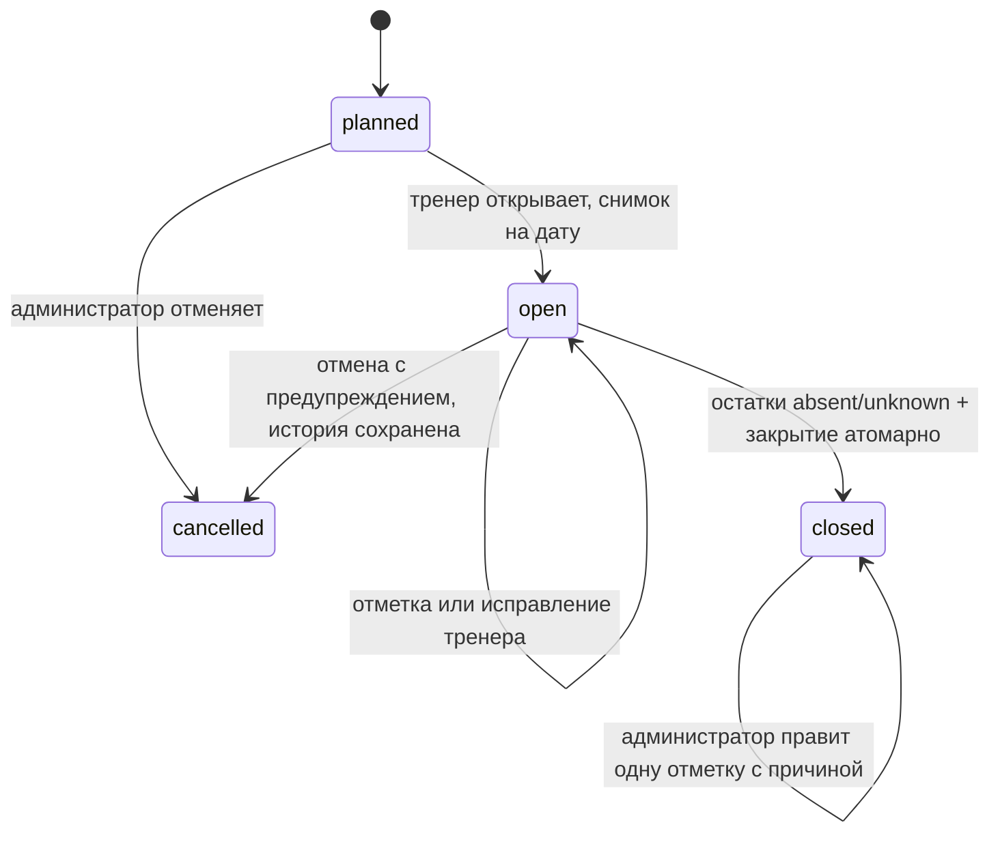
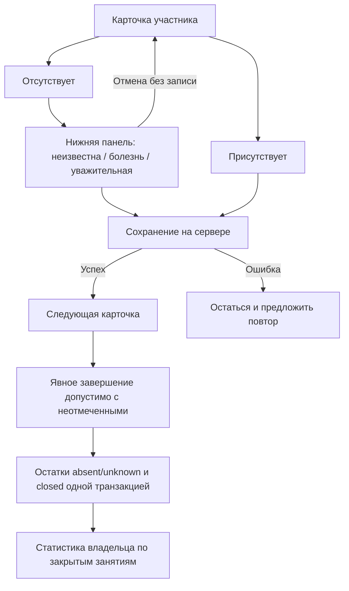

# Диаграммы минимальной v1

Версия 2.0, 12.10.2026. Предложение; соответствует [схеме из 12 таблиц](schema-v1.md). Будущие финансы/справки/импорт здесь не изображены, предыдущая версия сохранена в [истории](../archive/README.md).

Составные клубные FK и ограничения подробнее в схеме; ER не заменяет авторизацию и транзакционные проверки.

