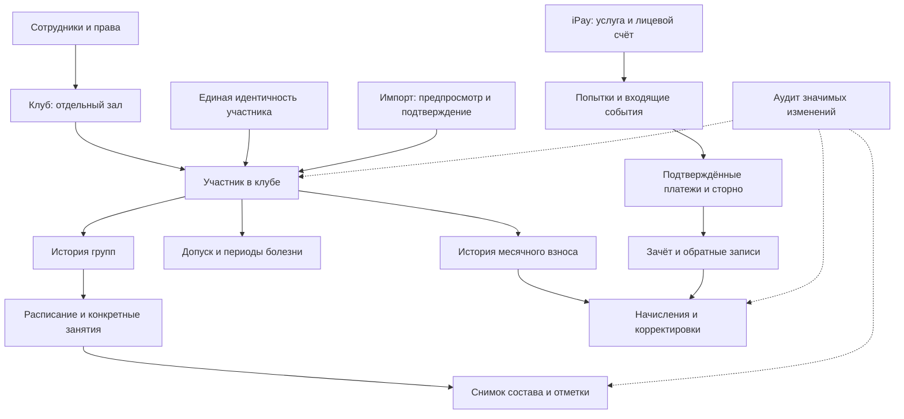
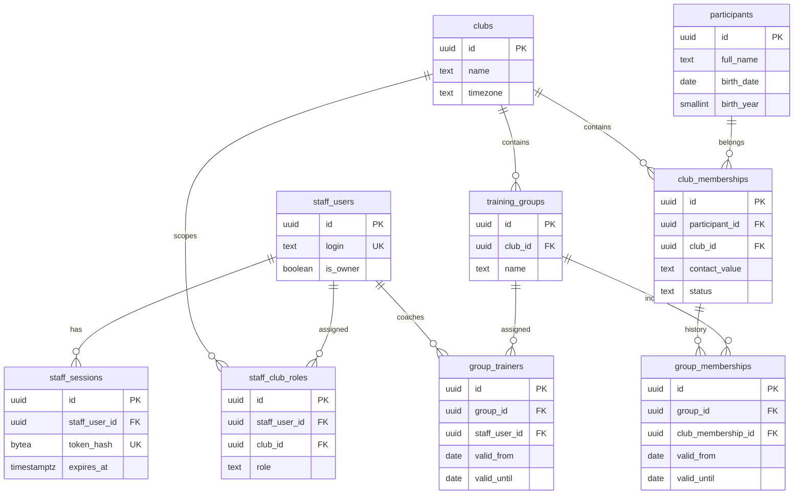
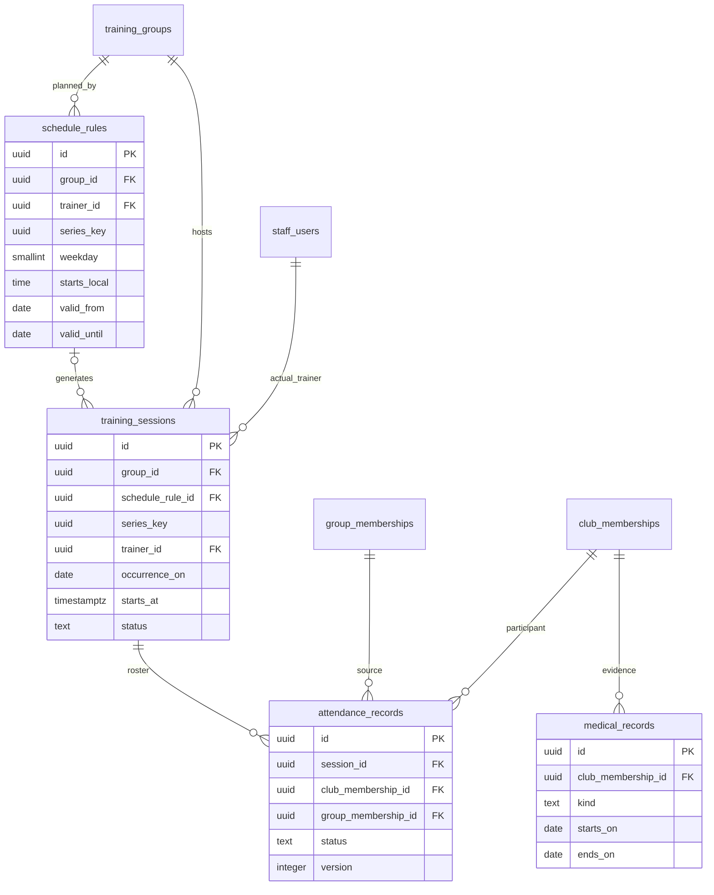
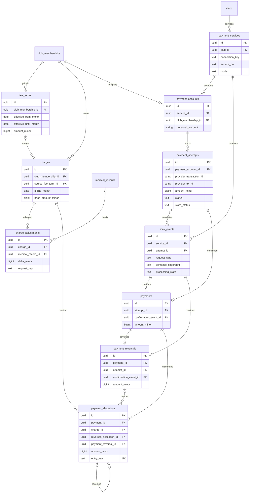
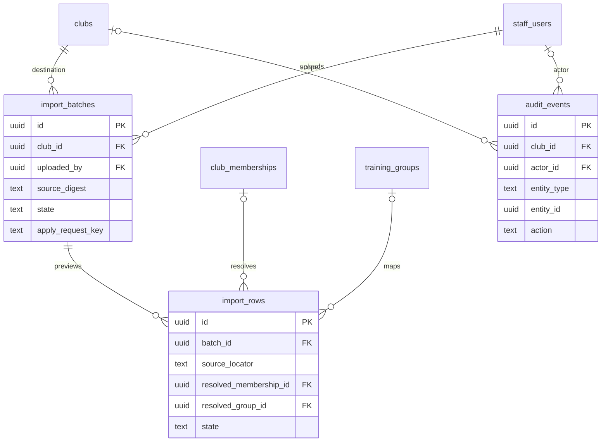
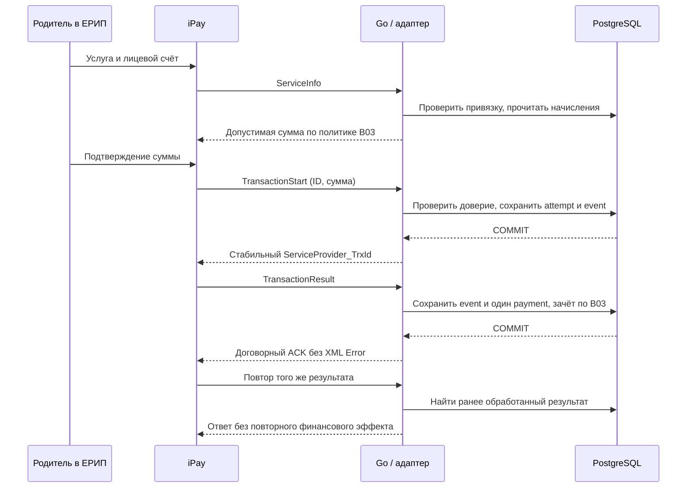
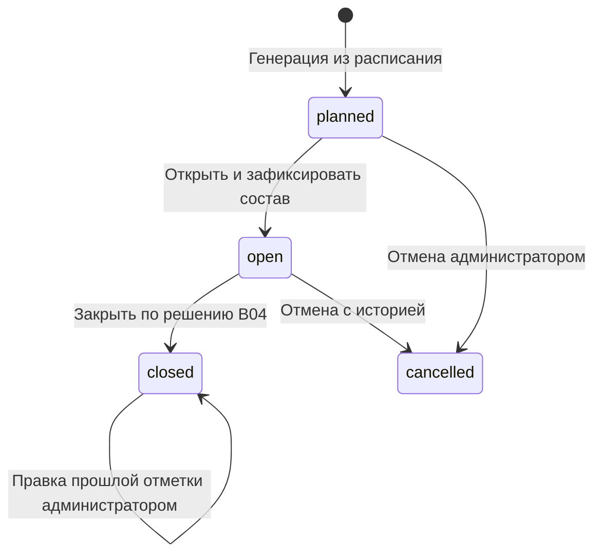

# Диаграммы JudeOSLite v1

Версия: 1.0, 11.10.2026. Статус: визуальное представление предложенной [схемы БД](schema-v1.md) и [архитектуры](../architecture-v1.md). Диаграммы Mermaid можно читать непосредственно в Markdown на GitHub и в поддерживающих Mermaid редакторах. Они не заменяют полный список полей, составных FK и транзакционных проверок.

## 1. Обзор областей

Финансы ограничены принадлежностью участника клубу. Общая идентичность не делает финансовые/медицинские данные доступными администратору другого зала.

## 2. Доступ и реестр — T01–T09

is_owner — общий доступ; роль administrator/trainer назначается отдельно клубу. Групповые периоды хранят историю, а не дублируют participants. Возможность нескольких групп в модели не утверждает гостевые сценарии.

## 3. Занятия и справки — T10–T13

schedule_rule_id и series_key могут отсутствовать только для согласованного исторического импорта. series_key сохраняет связь версий регулярного пункта: повторная генерация учитывает уже созданное, отменённое или перенесённое занятие. Состав фиксируется при открытии, а не пересчитывается по сегодняшней группе. Допуск и болезнь — виды medical_records; болезнь не уменьшает начисление автоматически.

## 4. Финансы и iPay — T14–T23

Диаграмма показывает смысл связи, а [schema-v1.md](schema-v1.md#integrity) задаёт составные FK по клубу/получателю/попытке. Один reversal на payment — предложенное полное сторно v1; частичные операции ждут B07. Отрицательная allocation ссылается на положительную, не заменяет её.

## 5. Импорт и аудит — T24–T26

NULL club_id аудита — только сетевое действие; NULL actor_id — системная операция/провайдер. entity_id — полиморфный указатель аудита, не универсальная связь бизнес-таблиц. Персональные данные импорта остаются в закрытой БД, не в репозитории.

## 6. Подтверждение платежа

Это успешная согласованная цепочка, не утверждение о настроенном подключении. Подпись проверяется до доступа к данным/изменений; на схеме действие объединено в обработку CRM. Неуспех/конфликт/неизвестная попытка имеют отдельные сценарии [архитектуры](../architecture-v1.md). Сумма хранится на старте, а не извлекается из результата.

## 7. Состояния занятия

Состояния и закрытие — инженерное предложение. Возврат закрытого занятия в open, отмена уже закрытого занятия и автопроставление отсутствия не считаются разрешёнными без B04. Отмена/замена не удаляет занятие и его audit.

## 8. Согласованность комплекта

T01–T26 соответствуют реестру схемы. Поля на диаграмме — ключевые, nullable/индексы/все общие поля читать в описании. Любое изменение связи или имени таблицы обновляется одновременно здесь, в схеме и в архитектуре; финальный план ссылается на нужную область, а не на одну нечитабельную общую ERD.
