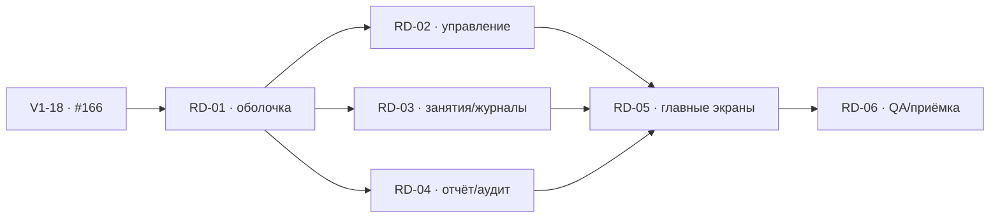

# План перехода на дизайн PRIDE

Подтверждённый заказчиком этап от 14.10.2026: перенос выбранного дизайна в существующее React-приложение после v1. **6 полных задач, 8 прямых зависимостей** (одна внешняя — V1-18 / #166). Это отдельный этап; 20 задач v1 не расширяются и не переименовываются.

Исходная проверенная версия: main `72460d8`, CI и Deploy test success. #149–#166, #167 и #170 закрыты. Приёмка v1 выполнена на согласованном вымышленном наборе; реальные данные/рабочий запуск и некоторые устройства отложены, не считаются проверенными. При исполнении перечитать актуальные протоколы.

Прототип `8016b74` сохраняется отдельно в design-system/prototypes/dashboard. Его файлы импортированы без изменения; в production используются React-компоненты, реальные API и серверные права. Источник решений — прямое поручение в текущем чате 14.10.2026.

## Порядок и параллельная работа

После RD-01 задачи RD-02–RD-04 независимы по результату, но правки app/shared/API/токенов согласуются: очередь предотвращает захват одного issue, а не коллизии разных файлов. RD-05 использует завершённые предметные экраны и read-only отчёт; RD-06 проверяет весь переход.

## Общие требования

- Идентичность PRIDE и выбранная композиция являются целью переноса, без новой концепции/бренда. Локальные размеры и семантические статусы документировать отдельно от значений источника.
- Полнота v1 важнее краткости демо: сохранить формы, четыре режима расписания, переносы, историю, ручные периоды, настройки пользователей и права.
- Прототипные данные, дата 12 октября, переключатель роли и демосохранение не являются production-контрактом.
- Правильный контекст ID/филиала, несколько назначений, server-side permissions, отмена устаревших запросов и очистка персональных данных обязательны.
- Offline queue, финансы, Excel, справки и новые сервисы не входят в этап.
- Все issues создаются Todo без исполнителей, штатные Blocked by сверяются с JSON. Назначение для реализации через общую очередь только по поручению пользователя, закрытие после готовности в main.

## Задачи

### RD-01 · [Оболочка PRIDE, навигация и общие компоненты ПК/телефона](https://github.com/NikishGum/JudeOSLite/issues/183)

**Прямые зависимости:** [V1-18 / #166](https://github.com/NikishGum/JudeOSLite/issues/166).

**Область:** frontend/src/app, frontend/src/shared/ui (только используемые компоненты), design-system, существующие e2e оболочки/PWA; docs/redesign-*.md.

**Что сделать**

- Перенести визуальную оболочку выбранной Working Panel в React: фиксированная навигация слева на ПК, верхний контекст филиала/пользователя, рабочая область; на телефоне нижняя навигация из трёх основных пунктов и «Ещё», safe-area. Вход и выход оформить в той же системе; не копировать HTML целиком или подключать prototype dashboard.js.
- Вместо длинного стека секций показывать выбранный раздел: главная, занятия, участники, группы, журналы, статистика, сотрудники, филиалы, история. Подключить существующие функциональные компоненты без потери их действий. Главная до RD-05 — компактный настоящий контекст и переходы, без вымышленных показателей. Раздел занятий объединяет календарь и редактор правил, сотрудников — доступное управление тренерами/администраторами; каждое существующее действие должно оставаться достижимым.
- Зафиксировать простую URL-модель раздела/филиала/детали с reload, прямой ссылкой, back/forward и совместимостью прежнего /clubs/:id. Проверить отдачу SPA через Go на прямом URL. Выбранная группа/период не превращаются в новые права; неподходящую ссылку обрабатывать понятно и безопасно.
- Сохранять актуальные серверные назначения. Владелец видит сеть, администратор только свои филиалы, тренер назначенные группы/занятия. Для нескольких ролей одного сотрудника не принуждать его к одному искусственному профилю: объединять разрешённые разделы, владельцу приоритет обзора, администратору рабочего дня, trainer-only тренировок. Переключатель ролей из preview в production не переносить.
- Кнопки, поля, статусы, панели и адаптивный диалог переиспользовать в пределах реально нужного UI. Rubik и оригинальный логотип локально; исходные PRIDE-токены сохраняются. Локальные семантические success/warning и плотность прототипа оформить документированными токенами рекомендаций, без нового бренда и тяжёлой библиотеки ради редизайна.
- Общие loading/empty/error/retry, видимый фокус, подписи, aria-current и текстовые статусы. Диалог на ПК справа, на телефоне снизу: фокус, Escape, возврат к инициатору и отсутствие прокрутки фона. Кнопки отмены type=button, submit явно; target ≥44px, мобильные поля и основные действия 16px, reduced-motion.
- Сохранить CSRF, expiry/logout, session-changed, pagehide/pageshow и очистку персонального DOM/BFCache из v1. Смена филиала/назначений отменяет запросы и очищает прежние данные. Уход с несохранённой формы/сохраняемого журнала обрабатывается без потери/обрыва; не удалять существующие защиты ради маршрутизации. PwaStatus, установка и уведомление обновления остаются доступны, кешируется только статика.
- В docs зафиксировать границы общих файлов/контракты навигации для RD-02–RD-05 и карту существующих функций по новым разделам. Статический прототип оставить отдельным референсом, его файлы не включать в production runtime.

**Готово, когда**

- Три отдельных аккаунта и многоролевой аккаунт получают правильные разделы на ПК и телефоне; каждый существующий v1-сценарий можно открыть. Отзыв доступа не оставляет чужие данные/пункты.
- Ссылки, reload и back/forward корректны; прежний клубный URL не ломается. На 320/390/768/1280/1440 px навигация и диалоги не перекрывают действия и не дают горизонтальный overflow.
- Вход, выход, установка/обновление PWA и приватность жизненного цикла проходят прежнюю регрессию; оформлена карта переноса, готовы общие компоненты без предметных заготовок.

**Проверка:** Frontend build/typecheck; существующие auth/PWA Chromium/WebKit e2e с реальными API/БД (проверять факты, не прежний DOM); browser smoke ролей/URL/отзыва/несохранённой формы; парные скриншоты ПК/телефона плюс 320px и keyboard/reduced-motion. Backend меняется только если необходима SPA-отдача, с проверкой защищённых API.

### RD-02 · [Реестр, группы, сотрудники и филиалы в новом рабочем пространстве](https://github.com/NikishGum/JudeOSLite/issues/184)

**Прямые зависимости:** [RD-01 / #183](https://github.com/NikishGum/JudeOSLite/issues/183).

**Область:** frontend/src/features/participants, groups, staff, clubs; документы предметных экранов; согласованные точечные связи с app/shared.

**Что сделать**

- Привести к новому языку PRIDE все существующие списки, карточки и формы участников, групп, тренеров, филиалов/назначений администраторов. ПК — читаемые строки/таблицы, телефон — последовательные карточки без горизонтального скролла; диалоги/панели наследуют RD-01.
- Реестр не ограничивать сокращённой демоформой: ФИО, полная дата рождения, локальный контакт родителя/взрослого, вступление, начальная группа, редактирование, архив/возврат, поиск и конфликт версий. Сохранить разрешённое редактирование общей идентичности только владельцем, однофамильцев и повторяющиеся семейные контакты не объединять.
- Группы: создание/изменение/архив, состав на выбранную дату, добавление/исключение/перевод и история интервалов. Снимки прежних занятий не переписывать. Действие «К занятиям группы» передаёт существующий group_id в навигацию; RD-03 применяет и показывает фильтр.
- Владелец управляет филиалами, администраторами и назначениями, администратор тренерами своих филиалов; сохранить отключение, отзыв, несколько назначений и подтверждение последствий архива. Trainer-only не получает контакты реестра или управление сотрудниками; «Мои группы» выводятся из разрешённого API, не из общего реестра.
- Для филиального управления требовать конкретный доступный филиал; в режиме «Вся сеть» не смешивать редактируемые карточки разных филиалов. Сохранять контекст в заголовках/формах. Нет API — загрузка/ошибка/повтор, нет записей — полезный следующий шаг, никакого synthetic fallback.
- После сохранения/архива/перевода обновлять только затронутые данные; отмена ничего не записывает. Быстрая смена филиала и отзыв роли отменяют запросы, убирают открытые карточки и черновики предыдущего контекста. Валидация/конфликт показываются рядом с действием без тихой перезаписи.

**Готово, когда**

- Все предметные операции v1 сохранены и доступны с ПК/телефона; формы реальных полей не заменены демоверсией.
- Поиск, архив/возврат, перевод на дату, история состава и управление назначениями проверены; прямое чтение чужих ID/контактов запрещено сервером.
- Переход к занятиям несёт ID выбранной группы, подтверждения и отмена понятны; смена контекста не оставляет чужих записей.

**Проверка:** Существующие participants/groups/clubs/staff API/изоляция и browser e2e на синтетических fixtures двух филиалов; keyboard/form validation/cancel/conflict; скриншоты списка/карточки/формы на 390 и 1280px, overflow320. Не менять реальные персональные данные ради теста.

### RD-03 · [Расписание, занятия и посещаемость по новому дизайну](https://github.com/NikishGum/JudeOSLite/issues/185)

**Прямые зависимости:** [RD-01 / #183](https://github.com/NikishGum/JudeOSLite/issues/183).

**Область:** frontend/src/features/schedule, sessions, trainer-sessions, attendance, journals; навигационные адаптеры, существующие training e2e; backend только при подтверждённом пробеле существующего контракта.

**Что сделать**

- Сделать единый раздел занятий с дневной/недельной лентой, выбором произвольной даты/периода и видимым фильтром доступной группы/филиала. Переход из группы/главной открывает именно её занятие, а не весь календарь; фильтр очищается явно. Не ограничивать календарь вымышленной неделей 12 октября из прототипа.
- Сохранить полное редактирование четырёх правил: дни недели, чётные/нечётные числа месяца, выбранные даты, разовое. Версии правил, выбранные дальние даты, отмена, перенос и замена тренера остаются; отменённые занятия видны с текстом статуса, не исчезают. Статусы planned/open/closed/cancelled и происхождение ручной замены понятны.
- Тренер видит только свои назначения, открывает журнал со снимком состава и последовательно отмечает кнопками без свайпов. ФИО/идентификация, прогресс, присутствие и отсутствие с тремя причинами; сохранение подтверждается сервером до перехода, отмена причины ничего не пишет.
- Сводка/возврат к предыдущим карточкам, исправление до закрытия, завершение даже с неотмеченными. Подтверждение показывает точное число будущих absent/unknown; двойной тап/сбой не создаёт дубль и не показывает ложный успех. После закрытия тренер не редактирует, повторный вход восстанавливает серверное состояние.
- Владелец/администратор просматривают журнал и исправляют одну закрытую отметку с обязательным change_reason, отдельно от absence_reason. Сохранить историю старого/нового значения, ожидаемую версию, конфликт с перечитыванием, архивных участников и отсутствие ограничения давности. Снимок состава не меняется; массового исправления и медицинских документов нет.
- Состояния пустого состава, уже закрытого/отменённого занятия, ошибки сети/повтора, отзыва назначения и конфликтов не позволяют продолжить запрещённое действие. Верхняя рабочая информация и крупные кнопки на телефоне не перекрываются нижней навигацией/клавиатурой; панель причин доступна фокусу и safe-area.
- Опубликовать стабильный минимальный контракт перехода «занятие/журнал» для RD-05 и обновления данных после mark/close/correct. Переиспользовать server API/транзакции, не переносить in-memory демонстрацию или offline queue.

**Готово, когда**

- Четыре режима расписания и действия администратора работают в новом экране с реальными API; фильтр по ID не смешивает одинаковые названия групп.
- Тренер проходит группу, отменяет причину, исправляет предыдущую и завершает с остатком; сбой не двигает карточку до ответа и reload восстанавливает запись.
- Закрытые отметки исправляются только уполномоченным сотрудником поштучно с причиной/историей; cancelled и trainer-only не дают запрещённую запись.

**Проверка:** Существующие schedule/sessions/attendance/corrections PG/API tests и Chromium/WebKit browser путь; double tap/ошибка/перезагрузка/close/correction conflict/два филиала; скриншоты ПК и телефона, 320px, клавиатура и Escape. Транзакционные правила и access matrix не ослаблять.

### RD-04 · [Статистика владельца и история изменений по новому дизайну](https://github.com/NikishGum/JudeOSLite/issues/186)

**Прямые зависимости:** [RD-01 / #183](https://github.com/NikishGum/JudeOSLite/issues/183).

**Область:** frontend/src/features/owner-dashboard, audit; используемые shared/report-представления и минимальные адаптеры для RD-05; existing reports/audit tests.

**Что сделать**

- Статистика владельца: компактная полоса показателей, сравнение филиалов/групп таблицей на ПК и читаемым списком на телефоне, присутствия/пропуски и все три причины. Сохранить все поля v1, включая planned/open, пустые closed и архивные сущности; не терять сведения ради краткого макета.
- Филиал/группа/произвольные включительные даты и быстрые Сегодня/Неделя/Месяц. Периоды вычислять от реальной локальной даты, явно определить неделю и месяц в docs (предлагается неделя Пн–текущая дата, месяц 1–текущая дата), сохранять ручной диапазон. Отчёт использует сохранённую timezone занятия, как API v1; не заменить её timezone браузера.
- Сохранить формулу present/(present+absent) только по closed, cancelled исключены, planned/open отдельно, нулевой знаменатель «—», округление до 0,1%, сумма причин равна отсутствиям. Расчёт на сервере по актуальным отметкам, без процентов из DOM/частичной страницы и без кэшируемого редактируемого итога.
- Клик по филиалу/группе выбирает их ID и контекст; переход в занятия несёт корректный фильтр. Отдельные report filters главной/отчёта и общий клубный контекст согласовать с RD-01, чтобы показываемые данные и заголовок совпадали, а архивный отчёт не разрешал будущие действия в архивном филиале.
- История изменений: время, сотрудник, филиал, вид и действие, период/действие/доступный филиал, стабильная серверная пагинация, новые сверху. Владелец — сеть и события без club_id, администратор — назначенные филиалы, trainer-only не получает раздел. Только уже разрешённые публичные поля: raw payload, контакты, логины и причины правок общего аудита не добавлять.
- Отмена устаревших запросов при фильтрах/назначениях/смене пользователя, loading/empty/error/retry, обновление после коррекции/закрытия, различение нуля и отсутствующих данных. Используемый read-only отчёт и сравнение сделать пригодными для RD-05 без дублирования формулы или масштабного refactor.

**Готово, когда**

- Ручной контроль совпадает с API/UI: два филиала, одинаковые названия групп, empty closed, cancelled/open/planned, перевод/архив и исправление. Причины сходятся, zero denominator «—».
- Фильтры, быстрые/ручные периоды, context drilldown и pagination истории работают с ПК/телефона и не раскрывают чужие данные.
- Обновление сохраняет честное состояние и исключает устаревшие ответы, опубликован повторно используемый read-only контракт отчёта для главной.

**Проверка:** Существующие reports/audit API tests, access матрица, контроль суммы и периода; browser быстрых/ручных дат, одинаковых названий и paging/retry/role revoke; парные скриншоты 390/1280, overflow320 и keyboard. Не добавлять экспорт Excel или финансовую аналитику.

### RD-05 · [Главные экраны владельца, администратора и тренера на реальных данных](https://github.com/NikishGum/JudeOSLite/issues/187)

**Прямые зависимости:** [RD-02 / #184](https://github.com/NikishGum/JudeOSLite/issues/184), [RD-03 / #185](https://github.com/NikishGum/JudeOSLite/issues/185), [RD-04 / #186](https://github.com/NikishGum/JudeOSLite/issues/186).

**Область:** frontend/src/features/dashboard и app-интеграция, минимальные shared hooks/adapters; backend/internal/dashboard и профильные сервисы только для необходимого авторизованного read endpoint; e2e ролей.

**Что сделать**

- Собрать выбранную Working Panel: владелец — период/группа, показатели закрытых журналов, сравнение филиалов, сегодня и незавершённые; администратор — день выбранного филиала, ближайшее open/planned занятие, участники/группы и открытые журналы; trainer-only — его ближайшее занятие, продолжить отметки, назначенные группы и сегодня.
- Владельцу вся сеть или конкретный филиал; администратору/тренеру только актуально доступный контекст. Для нескольких ролей сохранить реальные права и приоритет RD-01, не копировать демопереключатель. На телефоне занятие администратора/тренера перед счётчиками и основное действие в первом экране при обычном объёме заголовка; на ПК обзор и сегодняшний день рядом.
- Все даты/имена/числа из разрешённых API. Определить «сегодня», ближайшее и порядок в docs: локальная дата филиала, сначала открытое назначенное занятие, затем ближайшее запланированное; closed/cancelled не выдавать за текущую задачу. Для сети с разными timezone показывать локальную дату каждого филиала или явную границу сетевого обзора, не молча смешивать.
- Проверить наличие достоверных счётчиков и обзора сети в v1 API. Нельзя считать длину отфильтрованной/частичной страницы полным числом реестра, грузить каждый журнал ради прогресса или показывать фиктивные числа. Если контракта не хватает, здесь добавить один минимальный read-only endpoint/расширение в существующий Go, авторизацию и PG/API-тесты, без новых бизнес-сущностей/миграций/материализованных отчётов.
- Переиспользовать RD-03 переходы занятия/журнала и RD-04 отчёт, не дублировать расчёт посещаемости. Кнопки создания участника, открытия выбранного журнала/группы/филиала выполняют обещанное действие с context ID. После изменения состава/архива/отметки/закрытия/коррекции главная получает актуальные значения.
- Последние изменения — только разрешённый общий аудит для owner/admin, без private payload; тренеру не показывать историю сети. Отсутствие занятий/назначений/отметок, загрузка, частичный сбой независимого блока и retry понятны; зависимый запрещённый/устаревший блок не остаётся после logout/revoke. Ни synthetic fallback, ни жёстких дат/имён/чисел прототипа в production.

**Готово, когда**

- Три роли и многоролевой аккаунт видят соответствующую главную; назначенные IDs, даты и реальные счётчики сходятся с независимым контролем.
- Основные действия ведут к нужной записи/группе; данные обновляются после предметной операции. Ошибка одного блока не выдумывает нули и не сохраняет чужие данные.
- ПК/мобильная композиция соответствует референсу с сохранением v1-функций; отсутствуют демопереключатель, preview controls и хардкод.

**Проверка:** Browser → реальный API → PostgreSQL → показанные значения для двух филиалов/трёх ролей, multi-role/revoke/архив/границы даты/нет отметок/ошибка/повтор; проверить все счётчики независимыми запросами и API tests нового read endpoint при его появлении. Скриншоты 1440/1280/768/390/320 и доступность основных действий.

### RD-06 · [Сквозная проверка редизайна, PWA и передача сотрудникам](https://github.com/NikishGum/JudeOSLite/issues/188)

**Прямые зависимости:** [RD-05 / #187](https://github.com/NikishGum/JudeOSLite/issues/187).

**Область:** frontend/e2e, существующие access/training tests при выявленном дефекте, docs/testing-redesign.md и docs/acceptance-redesign.md; точечные исправления блокеров.

**Что сделать**

- Проверить весь путь на реальных API/БД: вход администратора → участники/контакт/группа/перевод → четыре режима расписания → отмена/перенос/замена → тренер/отметки/причины/закрытие → администратор/коррекция/история → владелец/статистика/главная. Только отдельно подготовленные синтетические fixtures, не реальные записи клуба.
- Регрессия ролей и прямых API, нескольких назначений, revoke, archive, session expiry, logout/change user, прямые URL/reload/back/forward, stale requests и несохранённые формы. Навигация не заменяет серверную защиту. Сохранить известные v1-ограничения/DEFERRED отдельно, не переписывать историю приёмки.
- Матрица 320/390/768/1280/1440: нет горизонтального overflow, наложения safe-area/нижней навигации/клавиатуры, панели и submit/cancel работают, focus order/trap/return, touch ≥44px, контраст обычного текста ≥4,5:1, крупного ≥3:1, основные мобильные действия/поля 16px, reduced-motion.
- Функциональная Chromium/WebKit регрессия и фактические Chrome/Edge ПК, iPhone/Safari и Android/Chrome по доступности. Реальные версии/устройства фиксировать; эмуляция не становится установкой PWA. Если устройства недоступны, записать NOT RUN/внешний блокер и согласовать изменение приёмки у заказчика; не закрывать по выдуманному PASS.
- Manifest/установка/standalone, cache только версионированной статики, отсутствие персонального API в Cache Storage, очистка DOM при lifecycle и возврате, обновление без обрыва сохранения. Потеря сети в mark/close/correct не даёт ложный успех, reload подтверждает серверный результат.
- После зелёного CI проверить согласованный HTTPS-стенд на проверенном SHA, роли и основные действия; не создавать новый pipeline/хостинг/backup. Подготовить короткие памятки ролей и список отличий от v1; получить явную оценку заказчиком нового интерфейса либо явно согласованный заменяющий объём.
- Исправить блокеры и приложить датированный протокол: что реально выполнялось, fixtures/браузеры/скриншоты, результаты, ограничения. Прототип остаётся отдельным reference; в production нет демоданных/панели роли/финансов/Excel/справок.

**Готово, когда**

- Автоматический сквозной сценарий и матрица прав проходят, итоговый отчёт/счётчики/история сходятся и существующие функции не потеряны.
- Согласованная матрица браузеров/PWA и визуальная приёмка фактически выполнены либо объём явно изменён заказчиком; NOT RUN/DEFERRED не названы PASS.
- Рабочий SHA в main с зелёными проверками, HTTPS smoke и датированным протоколом; памятки подготовлены, блокеров согласованного перехода нет.

**Проверка:** Это задача реально выполненной QA/приёмки, а не чеклист. Повторять только после изменений/сбоев; приложить команды, результаты и доказательства, не выдавать v1 CI или статический макет за проверку редизайна.

## Источники и исполнение

[Прототип](../design-system/prototypes/dashboard/README.md) · [Визуальный контракт](../design-system/prototypes/dashboard/DESIGN.md) · [Полные карточки JSON](implementation-tasks-redesign.json) · [Реестр GitHub](github-issues-redesign.json) · [Правила совместной работы](collaboration.md) · [Промпт исполнителя](task-agent-prompt.md).

## Новый выбранный shadcn-runtime — RD-07, 18.10.2026

Прямое поручение заказчика: [#198](https://github.com/NikishGum/JudeOSLite/issues/198),
ветвь `codex/shadcn-runtime`. Эталон — `origin/codex/shadcn-app-template` на
`17ecd57068cff17e4eaf055e0ac503b61cab0399`, `design-system/prototypes/shadcn-app/`.
Отдельный перенос всех рабочих экранов с существующими данными/API, ролями, полными
операциями, URL, lifecycle/CSRF/PWA/черновиками; обязательны Impeccable и shadcn.
Проверки1280/900/390/320, реальные Go/PG и synthetic роли, browser/PWA regression,
документы, commit/push/PR. Главная/реестр/группы/сотрудники/филиалы/занятия/расписание/
журналы/коррекции/отчёт/история входят целиком; демоинструменты не переносятся.

Прямая зависимость RD-05/#187: функциональная основа всех областей уже в main.
RD-06/#188 остаётся у прежнего исполнителя с отдельной приёмкой сотрудников;
она не закрывается этим поручением и не является технической зависимостью нового
визуального переноса. Сохранить её историю PASS/DEFERRED/NOT RUN. Прежние RD-01–06
и их выбранная Working Panel описывают предыдущий этап, не новый эталон.
Задача добавлена в существующий реестр для штатной очереди, без изменения claim,
назначения вручную, обхода зависимостей или начала product-кода до acquired=true.

## UX-GROUPS · #214 — Группы: состав и расписание, 20.10.2026

Прямое поручение заказчика: зарегистрировать и реализовать
[#214](https://github.com/NikishGum/JudeOSLite/issues/214). Прямые зависимости:
V1-06/#154 (датированный состав), V1-07/#155 (четыре режима),
V1-08/#156 (исключения), V1-09/#157 и V1-11/#159 (журналы/ограничения),
RD-02/#184 (группы), RD-03/#185 (существующие редакторы), RD-08/#200 (актуальный PRIDE).
Все закрыты, результаты входят в main9ca620d с зелёным Build and checks39416135812.
#188 не является зависимостью. #216 уже доставлен, его раздел не меняется.

Область: единое рабочее место группы, состав/множественное добавление,
регулярное расписание с даты и серверный preview, отдельные перенос/отмена/замена
в контексте группы. Сохранить Rubik/PRIDE и Impeccable; реальные серверные данные.
UI/маршруты/навигацию/CSS/редакторы/поведение «Занятий» и общие токены не менять.
Проверки адресные: группы/состав/правила/исключения, ПК/телефон, права/версии;
не новый полный E2E/PWA/device этап. Полные критерии — live issue.
Регистрация не назначает исполнителя: код только после штатного acquired=true.

## UX-STAFF · #215 — Сотрудники: карточка доступа Б, 20.10.2026

Прямое поручение заказчика: реализовать [#215](https://github.com/NikishGum/JudeOSLite/issues/215),
выбранный вариант Б из прототипа65acf6d, без повторного выбора концепции.
Прямые зависимости: V1-03/#151 (администраторы), V1-04/#152 (тренеры),
RD-02/#184 (предметный UI), RD-07/#198 и RD-08/#200 (текущий PRIDE/shadcn),
RD-09/#201 (единый staff/parent аккаунт). Все закрыты, результаты входят в main.
#214 и незавершённая приёмка #188 не являются зависимостями.

Область: единый согласованный реестр staff с несколькими role+club назначениями,
атомарное создание с первым назначением, точечные назначения/отзыв, существующие
операции данных/пароля/disable с прежними правами, сессиями/CSRF/аудитом. Parent-only
не входит, бывшие сотрудники сохраняются; общий аккаунт локальному admin не открывать.
UI: компактный список + карточка на ПК, последовательный переход на телефоне,
фильтры/фокус/черновики/серверные состояния. Обязателен Impeccable.
Адресные Go/PG/API и browser проверки, ПК/телефон, контракт/памятка/память, CI/main.
Регистрация не назначает исполнителя: product-код только после acquired=true.
