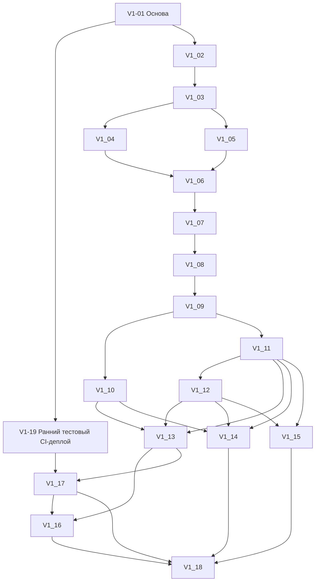

# План реализации первой версии JudeOSLite

Версия 2.0, 12.10.2026. **18 полных задач, 27 прямых зависимостей.** Согласованные границы заменяют план от 11.10.2026 на 148 задач. Приложение этим документом не реализуется.

## Подтверждённый состав

Источник: прямые запросы и ответы заказчика 11–12.10.2026. Первая версия: ручной реестр участников, формирование групп администратором, аккаунты и назначения тренеров, расписание/занятия, мобильная посещаемость и статистика владельца по филиалам. React, Go, PostgreSQL, VPS/Docker Compose, PWA.

Excel и отдельные медицинские документы отложены. Все финансы, суммы/начисления/долги/оплаты и iPay отложены до получения доступа к ЛК и уточнения взаимодействия. Эти функции **не входят ни в одну текущую задачу**. Сохранённые будущие требования и обязательные вопросы — [контекст](knowledge-base/crm-context.md), [iPay](knowledge-base/ipay.md), [история предыдущего комплекта](archive/README.md).

Регулярность: дни недели; чётные/нечётные даты; выбранные даты календаря; разовое занятие. Администратор назначает на занятия тренеров из списка своего филиала. Чётность именно числа дня месяца — явное инженерное допущение, не отдельный подтверждённый ответ.

Тренер: только кнопки, переход после сохранения; отсутствие открывает три причины. Завершение допустимо с неотмеченными: они атомарно становятся отсутствующими с неизвестной причиной. После закрытия администратор правит по одной с обязательной причиной, без ограничения давности.

Владелец: филиал/группа/период, проведённые занятия, присутствия, пропуски и их причины, процент. Знаменатель только отметки закрытых занятий; отменённые исключены, незавершённые отдельно. Проверить iPhone/Safari и ПК Chrome/Edge; Android/Chrome отложен по решению заказчика 13.10.2026 и не блокирует V1-16.

## Простая основа для развития

Последнее уточнение заказчика от 12.10.2026: нужен развиваемый фундамент без лишней сложности и ожидания сильного масштабирования. Один модульный Go-монолит, один React, одна PostgreSQL; явные SQL и обычные транзакции. Модули и таблицы добавлять по реальной задаче. Нет микросервисов, брокеров, ORM/универсальных repository/controller, event sourcing, CQRS, аналитического контура, пустых интеграционных адаптеров и предварительных финансовых/медицинских миграций.

Достаточный фундамент: устойчивые ID, клубные FK и серверная авторизация, нумерованные миграции, датированный состав/расписание, снимок состава занятия, небольшой аудит, защита нужных операций от дублей/конфликтов. Не создавать отдельную инфраструктурную задачу для каждого слоя.

[Архитектура](architecture-v1.md), [схема](database/schema-v1.md), [диаграммы](database/diagrams-v1.md) — инженерное предложение. [JSON карточек](implementation-tasks-v1.json) содержит те же полные задачи и служит источником переноса в GitHub. Изменять Markdown, JSON и issue согласованно.

## Совместная работа и порядок

[Правила совместной работы](collaboration.md) и [промпт исполнителя](task-agent-prompt.md) обязательны перед реализацией. Статус живёт в метках GitHub issues; Projects для первой версии не требуется. Нельзя начинать задачу, занятую коллегой, или считать закрытую зависимость выполненной без её результата в main.

Порядок определяется графом зависимостей, а не только номером. Первая — V1-01. После V1-03 можно параллельно делать V1-04 (тренеры) и V1-05 (участники): разные предметные области. После V1-09 — V1-10 (мобильный UI) и V1-11 (админский журнал), предварительно согласовав общие компоненты. После V1-13 — развёртывание V1-17, затем реальная PWA-проверка V1-16 на HTTPS; подготовку тестов можно делать заранее; межролевая и предметная проверка V1-14/V1-15 может идти отдельно после готовых предшественников. Независимость графа не разрешает одновременную правку одних файлов: согласовать владельца общих файлов/миграций, отдельные ветви и рабочие каталоги.

In review и обязательное ревью коллеги не требуются. Тесты внутри функций — часть готовности; V1-14–V1-16 проверяют сквозные риски, а не повторяют каждый CRUD. V1-17 включает реальное восстановление, V1-18 — пользовательскую приёмку. Недоступность устройств/VPS/заказчика отражать явно; не считать приёмку проведённой по одному чеклисту.

## Граф задач

## V1-01. Рабочая основа Go + React + PostgreSQL и проверки сборки

**Прямые зависимости:** нет.

**Основная область изменений:** backend/cmd, backend/internal/platform, frontend/src/app, deploy, .github/workflows.

**Что сделать**

- Зафиксировать минимальный стек: Go net/http, pgx и явные SQL; React + TypeScript + Vite. Проверить поддерживаемые версии по первичным источникам, закрепить зависимости.
- Создать один Go-сервис, одно React-приложение и PostgreSQL; локальный Docker Compose, конфигурацию через окружение, пример без секретов, корректное завершение и health/readiness.
- Добавить нумерованные SQL-миграции и единственный runner; Go отдаёт собранную статику, frontend разработки проксирует API. Задать формат JSON ошибок и общий API-клиент.
- Подключить существующие токены PRIDE, минимальную адаптивную оболочку и CI сборки/проверок. Только нужные каталоги; никаких заготовок модулей финансов, медицинских документов или интеграций.

**Готово, когда**

- Из чистого checkout по README запускаются UI, API и БД; миграции повторно применяются безопасно; сборки frontend/backend проходят в CI.
- Нет секретов в Git, публичного порта БД в production-шаблоне, ORM, брокера, универсального CRUD или инфраструктуры для предполагаемой большой нагрузки.

**Проверка**

- Проверить запуск с чистой БД, повторный запуск, отсутствие обязательной конфигурации и сборку production-образа.

## V1-02. Вход сотрудников, выход и серверная проверка доступа

**Прямые зависимости:** [V1-01](#v1-01).

**Основная область изменений:** backend/internal/auth, frontend/src/app, миграции доступа.

**Что сделать**

- Реализовать staff_users, staff_club_roles, staff_sessions, создание первого владельца локальной административной командой без пароля в Git.
- Вход/выход, получение текущего сотрудника и доступных филиалов; роли owner, administrator, trainer, несколько назначений одному сотруднику.
- Случайные серверные сессии с хранением хеша токена, сроком/отзывом, защищённой cookie, CSRF-защитой операций изменения, ограничением попыток входа и хешированием паролей поддерживаемой библиотекой.
- Проверять текущие права на сервере при каждом запросе; отключение аккаунта отзывает доступ. В UI — вход, защищённые маршруты и выбор доступного филиала.

**Готово, когда**

- Владелец видит сеть, администратор только назначенные филиалы; базовая клубная проверка переиспользуется предметными операциями без универсального permission engine.
- Неверный пароль, истёкшая сессия и отключённый сотрудник не дают доступ; выход закрывает сессию; парольные хеши/токены не выдаются клиенту и не попадают в логи.

**Проверка**

- Проверить вход/выход/отзыв, CSRF и границы клуба через API; полноценная межролевая матрица дополнительно в V1-14.

## V1-03. Филиалы и назначения администраторов для владельца

**Прямые зависимости:** [V1-02](#v1-02).

**Основная область изменений:** backend/internal/clubs, административные аккаунты auth, frontend/features/clubs.

**Что сделать**

- Создать clubs: название, адрес, часовой пояс, архив; каждый зал — отдельный филиал/клуб с собственным ID.
- Владелец создаёт и редактирует филиалы, создаёт администраторов, назначает одному сотруднику несколько филиалов, отзывает назначения и отключает аккаунты.
- Формы, списки и состояния ошибок; история существенных изменений в простом audit_events, без паролей и контактных payload.
- Архивирование сохраняет историю; не позволять создавать будущие занятия в архивном филиале. Общие аккаунты и назначения меняет владелец; администратор не выдаёт себе или другим роль владельца/администратора.

**Готово, когда**

- Владелец может подготовить два филиала с независимыми администраторами; администратор одного не читает и не меняет другой прямым API-запросом.
- Смена назначения действует сразу и не удаляет историю; подтверждение архивирования объясняет влияние на будущие операции.

**Проверка**

- Проверить несколько назначений, отзыв роли, архив и отказ в чужом филиале.

## V1-04. Создание и управление тренерами своего филиала

**Прямые зависимости:** [V1-03](#v1-03).

**Основная область изменений:** backend/internal/auth, frontend/features/staff.

**Что сделать**

- Администратор создаёт аккаунт тренера своего филиала, задаёт имя и логин, выдаёт первоначальный пароль безопасным способом; публичные ФИО с сайта не становятся реальными аккаунтами.
- Список доступных тренеров для назначения на занятия; новые/отозванные назначения, отключение и безопасная смена пароля.
- Для общего аккаунта нескольких филиалов администратор управляет только своим назначением; изменение общего логина/пароля/отключение всего аккаунта — владелец. Не раскрывать чужие назначения.
- Обработать занятый логин без автоматического присоединения чужого аккаунта; привязку существующего сотрудника к другому филиалу выполняет владелец. Audit для назначения/отзыва без секретов.

**Готово, когда**

- Администратор создаёт тренера, тренер входит и появляется в списке выбора своего филиала; повышать роль или менять чужой аккаунт администратор не может.
- Отзыв назначения прекращает доступ к занятиям этого филиала, исторический автор отметок сохраняется.

**Проверка**

- Создание/вход, дубли логина, попытка повышения роли, общий аккаунт двух филиалов и отзыв локального назначения.

## V1-05. Ручной реестр участников и карточки филиала

**Прямые зависимости:** [V1-03](#v1-03).

**Основная область изменений:** backend/internal/participants, frontend/features/participants, миграции реестра.

**Что сделать**

- Создать идентичность participants и локальную карточку club_memberships; ручной ввод ФИО, полной даты рождения, контакта родителя/взрослого и даты вступления.
- Список, простой поиск, карточка, редактирование, архив/возврат; контакт и состояние принадлежат филиалу. Список группы подключается в V1-06.
- Не объединять по ФИО/телефону и не делать семейный контакт уникальным. Администратор создаёт/редактирует идентичность, пока она связана только с его филиалом; общую идентичность нескольких филиалов редактирует владелец.
- У общей идентичности локальные контакты изолированы; сопоставление/объединение карточек, Excel, поля оплат и отдельные справки в v1 не реализуются.
- Архив не удаляет историю занятий и отметок; конфликт изменений возвращается пользователю без тихой перезаписи.

**Готово, когда**

- Администратор вручную заводит и находит участника, меняет свой контакт, архивирует и восстанавливает карточку; соседний филиал недоступен.
- Два ребёнка могут иметь одинаковый контакт; однофамильцы остаются разными карточками; нет выдуманной даты рождения.

**Проверка**

- Валидация дат/контакта, дубли имени/телефона, клубная изоляция и сохранение исторических ссылок после архива.

## V1-06. Группы и датированная история состава

**Прямые зависимости:** [V1-04](#v1-04), [V1-05](#v1-05).

**Основная область изменений:** backend/internal/training/groups, frontend/features/groups, group_memberships.

**Что сделать**

- Администратор создаёт/редактирует/архивирует группы своего филиала; выбирает участников из ручного реестра.
- Добавление, исключение и перевод между группами с датой действия; интервалы [from, until), NULL конец открыт, перевод — одна транзакция.
- В форме нового участника можно сразу указать группу; создание карточки и начального состава атомарно. Показывать состав на выбранную дату и понятную историю переводов.
- Не допускать перекрывающиеся интервалы одной пары участник–группа или автоматические гостевые/параллельные посещения. Архив/перевод не переписывает снимки открытых и закрытых занятий.
- Доступ тренера к группе выводится из его назначенных правил/занятий; отдельную универсальную систему назначений групп не строить.

**Готово, когда**

- Можно сформировать группу, перевести участника с определённой даты и увидеть прежний состав; связь группы и участника другого филиала отвергается.
- Прошлая посещаемость не меняется от перевода или архива; текущий состав не выдаётся за исторический.

**Проверка**

- Границы дат, перевод в транзакции, возврат, пересечение периодов и недопустимые межклубные связи.

## V1-07. Расписание: дни недели, чётность дат, календарные даты и разовое занятие

**Прямые зависимости:** [V1-06](#v1-06).

**Основная область изменений:** backend/internal/training/schedule, frontend/features/schedule, schedule_rules.

**Что сделать**

- Администратор выбирает группу, тренера из списка своего филиала, время и длительность; четыре понятных режима: выбранные дни недели, чётные/нечётные числа месяца, список выбранных дат календаря, разовое занятие.
- Чётность трактовать по числу дня месяца (инженерное допущение от 12.10.2026); не по номеру недели. Режимы отдельные, без произвольного конструктора комбинаций.
- Для регулярных правил — начало и необязательный конец действия, локальные даты филиала (Europe/Minsk по умолчанию). Разовый сеанс без правила, выбранные даты — конечный список.
- Генерировать weekly/parity на текущий и следующий месяц при старте/периодически в том же Go-процессе; явные выбранные даты создавать все, включая дальше горизонта. Повторный запуск и перезапуск не дублируют занятия.
- Изменение правила с выбранной даты закрывает старую версию; обновляет только будущие неоткрытые обычные занятия, сохраняет отмены/ручные замены и уже открытые/закрытые журналы. Перед применением показать затрагиваемые будущие занятия.
- Проверять действующий филиал/группу/тренера, недопустимые периоды и дубль группы в одно время; не превращать отменённое занятие обратно в плановое при генерации.

**Готово, когда**

- Все четыре режима доступны из формы; предпросмотр совпадает с созданными датами, чётность корректна на границах короткого/длинного месяца.
- Повторный запуск не создаёт дублей, переход месяца создаёт нужный горизонт; изменения и повторная генерация сохраняют исключения и историю.

**Проверка**

- Проверить 28/29/30/31 день, смену месяца/года, несколько дней недели, дальние выбранные даты, разовое занятие и повторный/одновременный запуск генерации.

## V1-08. Календарь занятий, отмена и замена тренера администратором

**Прямые зависимости:** [V1-07](#v1-07).

**Основная область изменений:** backend/internal/training/sessions, frontend/features/sessions.

**Что сделать**

- Администратор видит календарь/список по группе и периоду, дату/время, фактического тренера и статус занятия.
- Создать разовое занятие, отменить плановое с причиной, заменить тренера из списка своего филиала на конкретном занятии.
- Ручные исключения хранить в самом занятии; генератор не стирает их. В закрытом занятии нельзя заменой тренера/времени переписать авторство и историю.
- Отменённое занятие не создаёт автоматических отсутствий и исключается из статистики. Для открытого журнала отмена требует предупреждения, сохраняет снимок/историю и закрывает запись; закрытое занятие из UI отменять не разрешать в v1.
- Конфликты одновременного изменения возвращать явно; аудит отмены и замены.

**Готово, когда**

- Отмена и замена видны тренеру после обновления и не исчезают после генерации; прежний тренер теряет возможность писать в заменённый сеанс.
- Не допускаются тренер/группа из чужого филиала; отмена не записывает пропуски и не удаляет исторические отметки.

**Проверка**

- Проверить отмену до/после открытия, замену, регенерацию, конфликт редактирования и запрет правки закрытого сеанса.

## V1-09. Журнал занятия: снимок состава, отметки и атомарное завершение

**Прямые зависимости:** [V1-08](#v1-08).

**Основная область изменений:** backend/internal/training/attendance, attendance_records, frontend/features/trainer-sessions.

**Что сделать**

- Список назначенных тренеру занятий (сегодня/выбранная дата), состояния planned/open/closed/cancelled, открытие доступного занятия.
- При первом открытии атомарно фиксировать состав на локальную дату занятия в attendance_records; он не меняется от последующих переводов/архива.
- API отдельной отметки: присутствует или отсутствует с причиной unknown/illness/excused. До закрытия запись может быть неотмеченной; повтор идентичной команды не создаёт новую отметку.
- Тренер своего фактического занятия исправляет отметки до завершения; завершает даже с неотмеченными. В одной транзакции оставшиеся становятся absent/unknown и журнал закрывается.
- Сериализовать отметку/закрытие/отмену/замену блокировкой строки занятия; повтор открытия/закрытия безопасен, после закрытия тренер не меняет записи.
- История значимых изменений сохраняет автора/время, старую и новую отметку, источник ручной отметки/автоматического отсутствия; никаких очередей или event sourcing.

**Готово, когда**

- Снимок создаётся один раз, закрытие не оставляет неотмеченных и не проходит частично; повторный запрос не дублирует журнал.
- Гонка последней отметки и завершения сохраняет однозначное состояние; отменённое/чужое занятие нельзя отметить; администраторские изменения закрытого журнала — в V1-11.

**Проверка**

- Реальная БД: повторные запросы, пустая группа, перевод после открытия, гонки mark/close и cancel/close, откат при ошибке транзакции.

## V1-10. Мобильные карточки посещаемости тренера с кнопками и выбором причины

**Прямые зависимости:** [V1-09](#v1-09).

**Основная область изменений:** frontend/features/attendance, общие мобильные компоненты.

**Что сделать**

- Последовательные карточки участников группы: ФИО, понятная идентификация, прогресс и две крупные кнопки «Присутствует» / «Отсутствует». Свайпов нет.
- «Присутствует» сохраняет отметку и после ответа сервера переходит дальше; «Отсутствует» открывает нижнюю панель с вариантами «Неизвестна», «Болезнь», «Уважительная». Выбор сохраняет и затем открывает следующую карточку; отмена панели ничего не записывает.
- Панель адаптирована под телефон: крупные строки, видимая отмена, safe area, фокус/доступность. Болезнь — причина отсутствия, не медицинская справка.
- Вернуться к предыдущим отметкам через краткий список/сводку, исправить до закрытия. Явная кнопка «Завершить» доступна при неотмеченных, показывает сколько станут absent/unknown; отмена подтверждения не закрывает журнал.
- Повторный вход загружает серверное состояние; защита от двойного нажатия, ошибка/повтор при потере связи. Не переходить дальше до подтверждённого сохранения; офлайн-очереди нет.
- Состояния пустой группы, уже закрытого/отменённого занятия, отозванного доступа и конфликта; работа на узком экране без горизонтальной прокрутки.

**Готово, когда**

- Тренер проходит группу только кнопками, корректирует предыдущую отметку и завершает журнал с оставшимися участниками по согласованному правилу.
- Ошибка сети не отображает ложное сохранение; перезагрузка продолжает с серверного состояния; нижняя панель работает пальцем и клавиатурой.

**Проверка**

- Проверить присутствие, каждую причину, отмену панели, двойное нажатие, возврат, перезагрузку, ошибку сети и закрытие с неотмеченными.

## V1-11. Журнал администратора и поштучное исправление закрытых отметок

**Прямые зависимости:** [V1-09](#v1-09).

**Основная область изменений:** backend/internal/training/corrections, frontend/features/journals.

**Что сделать**

- Журнал своего филиала с фильтрами по группе/дате, составом снимка, статусами присутствия/причинами и историей изменений.
- Администратор (и владелец в выбранном филиале) меняет после закрытия только отдельную отметку, с обязательным текстом причины исправления и без ограничения давности.
- Различать absence_reason и change_reason; смена на присутствие убирает причину отсутствия, но не историю. Массового изменения и автоматической правки по справке нет.
- Проверить ожидаемую версию записи, сохранить старое/новое значение, автора, время и причину атомарно; показать конфликт с возможностью перечитать запись.
- Не открывать закрытый журнал для записи тренером и не менять снимок состава; медицинских документов в форме нет.

**Готово, когда**

- Можно исправить давнюю закрытую отметку с причиной, увидеть историю; без причины и на чужом филиале операция отвергается.
- Одновременные исправления не затирают друг друга; статистика использует актуальные значения, аудит сохраняет предыдущие.

**Проверка**

- Пустая причина, изменение типа отметки, давняя дата, конфликт версий, исторический участник после архива и отсутствие прав тренера.

## V1-12. Статистика владельца по филиалам, группам и периоду

**Прямые зависимости:** [V1-11](#v1-11).

**Основная область изменений:** backend/internal/reports, frontend/features/owner-dashboard.

**Что сделать**

- Отчёт владельца: фильтры филиал/группа/период, количество проведённых (closed) занятий, присутствий и пропусков, разбиение причин пропусков, процент посещаемости.
- Процент = present / (present + absent) по отметкам закрытых занятий, умноженный на 100; cancelled исключены, незавершённые занятия показываются отдельно и не входят в знаменатель.
- Количество занятий считать отдельно от количества отметок, включая закрытые занятия с пустым составом; нулевой знаменатель показывать как «—», не выдумывать 0%.
- Вычисления SQL по фактическому снимку и текущим исправленным отметкам; перевод/архив не меняет историческую группу/филиал. Период по локальной дате занятия, явно обозначить границы и округление.
- Общий обзор сети и сравнение филиалов/групп в простой таблице/диаграмме на адаптивном экране. Нет финансов, отдельной аналитической БД, сохранённых редактируемых итогов или materialized views без измеренной необходимости.

**Готово, когда**

- Ручной контрольный пример совпадает с API и UI: закрытые входят, отменённые исключены, незавершённые отдельно, причины дают сумму пропусков.
- После поштучного исправления итог обновляется; одинаковые названия групп разных филиалов не объединяются; статистика сети доступна владельцу.

**Проверка**

- Контрольный набор двух филиалов: закрытое/открытое/отменённое занятие, пустой состав, перевод, архив, коррекция и нулевой знаменатель.

## V1-13. Адаптация всех ролей и установка PWA

**Прямые зависимости:** [V1-10](#v1-10), [V1-11](#v1-11), [V1-12](#v1-12).

**Основная область изменений:** frontend/src/app, frontend/shared, manifest/service worker.

**Что сделать**

- Довести мобильную/настольную адаптацию входа, реестра, групп, расписания, журнала и статистики на существующей дизайн-системе PRIDE.
- Manifest, иконки, установка PWA, standalone-режим, safe area и краткая подсказка установки для iPhone/Safari и Android/Chrome.
- Service worker кеширует только версионированную статику оболочки; API и персональные данные не попадают в Cache Storage. Нет офлайн-изменений и очереди синхронизации.
- Проверить выход, истечение сессии и обновление приложения: очищать отображаемые личные данные, не показывать старый журнал другому сотруднику; обновление не обрывает незавершённое сохранение.
- Общие loading/empty/error состояния, читаемые подписи, доступные формы/фокус и крупные кнопки. Финансовые/медицинские заглушки и пункты меню не добавлять.

**Готово, когда**

- Все три роли выполняют основные действия на телефоне и ПК; PWA устанавливается и открывает корректный вход/текущую сессию.
- Кеш содержит только статику; при отсутствии сети приложение ясно сообщает о недоступности операций и не обещает сохранение.

**Проверка**

- Проверить manifest/обновление/cache/logout локально; реальная матрица устройств и установки — V1-16.

## V1-14. Проверка изоляции филиалов и полной матрицы ролей

**Прямые зависимости:** [V1-10](#v1-10), [V1-11](#v1-11), [V1-12](#v1-12).

**Основная область изменений:** backend/tests/integration/access, тестовые фикстуры.

**Что сделать**

- Автоматизированные проверки на реальной PostgreSQL с синтетическими данными двух филиалов, владельцем, администраторами и тренерами, в том числе с несколькими назначениями.
- Прямые API-запросы на чужие ID: участники/контакты, группы/состав, расписания/занятия, отметки/аудит, аккаунты и отчёт сети.
- Отзыв роли, отключение сотрудника, подмена club_id/group_id/session_id, попытка повышения прав, замена фактического тренера, исправление закрытого журнала тренером.
- Проверять отсутствие утечки через списки, поиск, счётчики и сообщения ошибок; ограничения действуют на сервере, а не только в меню. Исправить найденные нарушения в соответствующих функциях.
- Зафиксировать команды запуска и покрытую матрицу; не использовать реальные контакты/пароли клуба.

**Готово, когда**

- Владелец получает сеть; каждый администратор — свои филиалы; тренер — назначенные группы/занятия и разрешённые операции. Все запрещённые чтения/изменения отклонены.
- CI запускает проверяемую матрицу; отзыв доступа срабатывает без повторного входа; чужие контакты не присутствуют в ответах.

**Проверка**

- Это задача проверки: результат — исполняемые сценарии, исправленные нарушения и краткий отчёт, а не чеклист без выполнения.

## V1-15. Проверка расписания, исторических данных и конкурентных отметок

**Прямые зависимости:** [V1-11](#v1-11), [V1-12](#v1-12).

**Основная область изменений:** backend/tests/integration/training, SQL-фикстуры.

**Что сделать**

- Интеграционные тесты расписания: все четыре режима, чётность дат, границы месяцев/года, повторный/одновременный запуск, дальние выбранные даты, смена версии правила.
- Отмена и ручная замена переживают регенерацию; перевод/архив не меняют снимок открытого/закрытого сеанса; неверные межклубные связи запрещены.
- Одновременные open/open, mark/close, close/close, cancel/close и замена/mark; ошибки транзакции не оставляют частичный снимок или частичное закрытие.
- По закрытии все оставшиеся absent/unknown; повтор команды безопасен; конфликт поштучных исправлений не затирает значения.
- Сверить отчёт владельца с независимо посчитанным контрольным набором, включая причины, пустую группу, отменённые и незавершённые; исправить найденные ошибки.

**Готово, когда**

- Проверки проходят на реальной БД и в CI, без дублей/частичных состояний; контрольные значения статистики совпадают.
- Зафиксированы реально проверенные границы и ограничения; нет добавленных платёжных/медицинских тестов или искусственных требований большой нагрузки.

**Проверка**

- Повторять гонки ограниченное число раз и проверять инварианты БД, не только HTTP-код.

## V1-16. Сквозные проверки браузеров и мобильной PWA

**Прямые зависимости:** [V1-13](#v1-13), [V1-17](#v1-17).

**Основная область изменений:** frontend/e2e, docs/testing-v1.md.

**Что сделать**

- Реальную установку PWA проверять на HTTPS-развёртывании из V1-17; подготовка сценариев может идти заранее, зависимость обязательна для завершения.
- Автоматизировать основной путь: вход администратора → тренер/участники/группа → четыре вида расписания/сеанс → вход тренера → карточки/причины/закрытие → коррекция администратора → статистика владельца.
- Ручные проверки на iPhone/Safari и ПК Chrome/Edge: размеры, ввод дат/контактов, нижняя панель, safe area, установка и повторный запуск PWA. По решению заказчика 13.10.2026 Android/Chrome отложен, не блокирует #164; возможные ошибки разбираются отдельно.
- Проверить двойной тап, ошибку/разрыв связи при сохранении, перезагрузку открытого журнала, отзыв доступа, закрытое/отменённое занятие и выход со сменой пользователя.
- Записать реальные устройства/версии и результаты; эмуляция дополняет, но не заменяет реальную установку обязательных iPhone/Chrome/Edge. Если эти проверки недоступны, явно оставить приёмку незавершённой. Android пометить DEFERRED / NOT RUN по решению заказчика, не PASS.
- Исправить блокирующие UX/браузерные ошибки; сохранить короткую воспроизводимую инструкцию и синтетические тестовые данные.

**Готово, когда**

- Основной сквозной путь проходит; обязательные браузеры и реальная установка PWA проверены либо явно обозначен внешний блокер — задачу нельзя закрыть по одной эмуляции.
- Нет горизонтальной прокрутки основных мобильных экранов и ложного сохранения при сетевой ошибке.

**Проверка**

- Это задача QA: приложить выполненные автоматические и ручные результаты, перечень исправлений и оставшиеся ограничения.

## V1-17. Развёртывание на VPS, HTTPS и восстановление резервной копии

**Прямые зависимости:** [V1-13](#v1-13), [V1-19](#v1-19).

Переиспользовать ранний тестовый pipeline V1-19. Здесь остаются приёмка полной CRM, HTTPS-вход/PWA, регулярный локальный backup и восстановление предметных данных. Решение владельца 13.10.2026: только VPS, ежедневно 03:00 Europe/Minsk, 7 последних завершённых плюс current/previous/operation, incomplete/unknown сохранять; offsite не входит в приёмку.

**Основная область изменений:** deploy, .github/workflows/deploy при необходимости, docs/operations-v1.md.

**Что сделать**

- Production Docker Compose: HTTPS-прокси, Go с React-статикой и PostgreSQL; внешняя БД недоступна, секреты вне Git, healthchecks и понятная процедура обновления.
- Подготовить и проверить развёртывание на согласованном VPS/домене с TLS; применять миграции одним runner, не параллельно каждым экземпляром.
- Настроить регулярный backup БД с согласованным местом хранения/сроком, выполнить восстановление в отдельную чистую БД и сверить пользователей/состав/занятия/отметки/аудит.
- Перезапуск не дублирует генерацию занятий и не теряет отметки; логировать технические ошибки без паролей/контактов. Короткая инструкция диагностики, обновления и отката приложения с учётом совместимости схемы.
- Без Kubernetes, отдельного job-сервиса, репликации, сложного мониторинга и внешних интеграций. Доступ/домен/backup-политика запрашиваются при исполнении, не считаются имеющимися.

**Готово, когда**

- Рабочая версия доступна по HTTPS, вход и PWA функционируют; повторный запуск сохраняет данные, миграции безопасны.
- Резервная копия действительно восстановлена и проверена; есть инструкция для второго разработчика. При отсутствии доступа VPS задачу не закрывать как развёрнутую.

**Проверка**

- Smoke после обновления/рестарта, реальное restore в отдельную БД, TLS/cookie, непубличный порт БД и отсутствие секретов в образе/логах.

## V1-18. Приёмка первой версии и запуск с ручным вводом данных

**Прямые зависимости:** [V1-14](#v1-14), [V1-15](#v1-15), [V1-16](#v1-16), [V1-17](#v1-17).

**Основная область изменений:** docs/acceptance-v1.md, docs/operations-v1.md, исправления блокеров.

**Что сделать**

- Решение заказчика 13.10.2026: «Нет, просто придумай вымышленное, и всё». Завершить на согласованном вымышленном наборе с фактическим проходом исполнителя; реальные данные и рабочий запуск отложены.
- Согласовать несколько контрольных филиалов, роли владельца/администратора/тренера и отдельные аккаунты. Персональные данные будущего рабочего реестра вводить только через защищённую систему, не через Git/публичные issues.
- Выполнить фактический HTTPS-контроль каждого режима расписания и полный путь администратора, тренера и владельца; подготовить отдельный вымышленный набор вручную через UI, без переиспользования QA164.
- Сверить состав на дату, назначение тренера, присутствия/три причины/автоотсутствия, поштучную коррекцию и формулу отчёта; проверить архивирование и перевод с сохранением истории.
- Убедиться, что завершены зависимости и проверено восстановление; передать краткие инструкции ролям, записать ограничения и устранить блокеры первой версии.
- Подтвердить, что в меню/задачах/фоновых процессах нет оплат, iPay, Excel и медицинского реестра. Будущая финансовая автоматизация, старые долги и способы оплаты обсуждаются отдельно после доступа iPay и перед будущими платёжными тестами.
- QA164 и CI не считать пользовательской приёмкой. Личный просмотр заказчиком, понимание инструкций сотрудниками, реальные назначения/данные и рабочий запуск отложены; неподтверждённые факты не придумывать. Android DEFERRED / NOT RUN по решению заказчика и не блокирует завершение.

**Готово, когда**

- Заказчик согласовал вымышленный набор и самостоятельный проход исполнителя. Фактический HTTPS-сценарий завершён, данные и независимый отчёт сходятся, продуктовых блокеров в согласованном контроле не обнаружено; короткие инструкции ролям подготовлены.
- Документированы решение об объёме, выполненные результаты и ограничения. Реальные данные/обучение/рабочий запуск и Android отмечены отложенными, не PASS; отложенные функции не включены обратно в первую версию.

**Проверка**

- Приложить датированный протокол фактически выполненного HTTPS-контроля с реальными средой/версией браузера и исполнителем, независимой сверкой отчёта и результатами CI/deploy; отдельно записать решение заказчика, не выдумывать пользовательские проверки или дату рабочего запуска.

## V1-19. Автоматический деплой тестового стенда после успешного CI в main

Добавлено по поручению владельца 12.10.2026: ранняя инфраструктурная задача [#167](https://github.com/NikishGum/JudeOSLite/issues/167), в дополнение к 18 продуктовым задачам; номера не изменяются.

**Прямая зависимость:** V1-01 (#149), уже выполнена в main. Можно готовить до V1-13.

Доставка проверенного main по GHCR digest, Caddy/HTTPS, ограниченный SSH judeos-deploy, ручной bootstrap и секреты, backup перед миграциями, readiness, постоянные данные, защита от concurrent/stale запусков, явный restore в отдельную БД и совместимый rollback. DEPLOY_PATH=/srv/judeos-test.

Владелец самостоятельно настраивает VPS/Secrets и сообщает результаты первого деплоя. Cloud-проверки и PR не являются серверной приёмкой. Issue открыта до результата в main и реальных проверок. V1-17 использует эту инфраструктуру для полной CRM и предметного восстановления после V1-13.

## V1-20. Просмотр истории изменений владельцем и администратором

Добавлено по прямому поручению владельца 12.10.2026: [#170](https://github.com/NikishGum/JudeOSLite/issues/170). Прямая зависимость — готовая V1-07/#155, параллельно V1-08.

Переиспользовать audit_events: время, автор, филиал, тип записи и действие; фильтры по филиалу/периоду/действию и стабильная пагинация. Owner видит сеть/архив/события без club_id; administrator — только текущие назначения, trainer без administrator-роли не видит историю. Raw states/reasons, пароли/контакты/логины не возвращать.

Проверить PostgreSQL/API изоляцию, отзыв прав, границы периода, порядок страниц и приватность; браузер 320/390/1280, фильтры, пустой список, ошибку/retry/смену аккаунта. Полные критерии — в issue. Регистрация не является назначением или результатом реализации.
